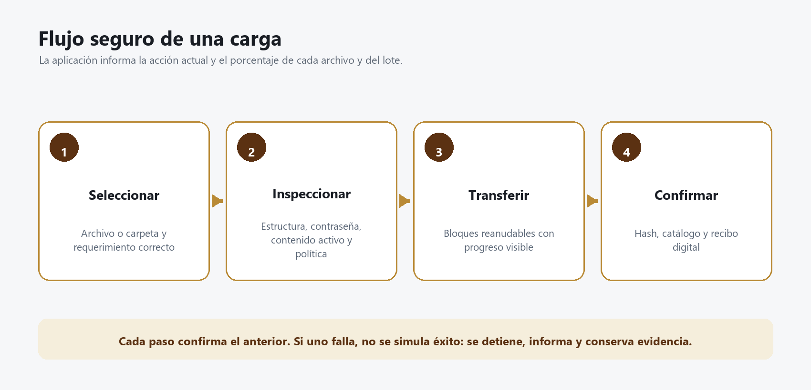
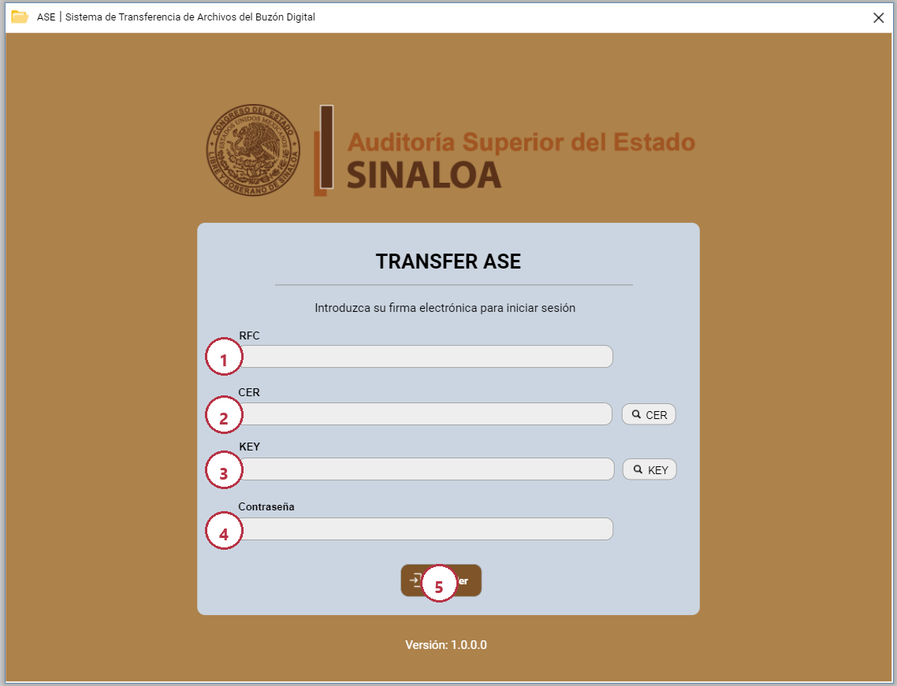
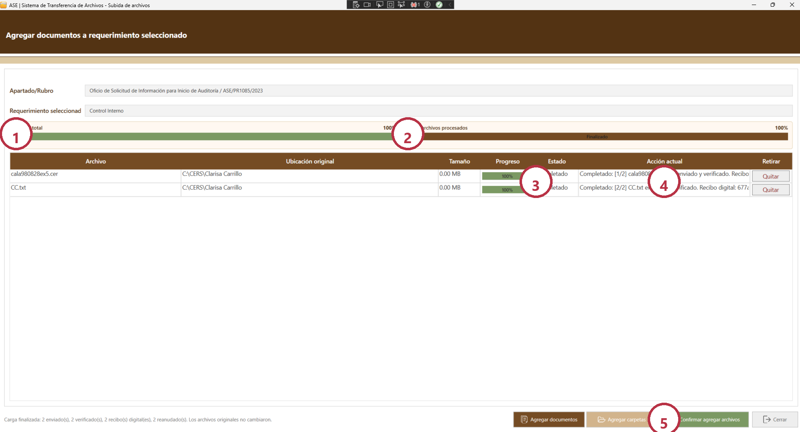
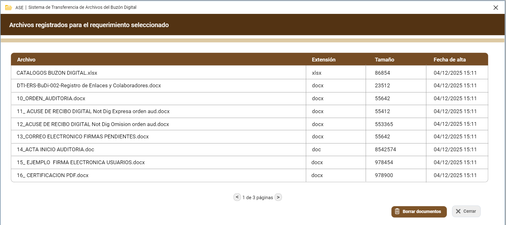

# Manual de usuario de TransferClienteASE

## Antes de comenzar

Este manual explica cómo entrar al cliente Transfer ASE, localizar un requerimiento, seleccionar archivos, verificar su integridad, enviarlos, reanudar una carga interrumpida y consultar o descargar documentos registrados.

### Lo que debe tener a la mano

- Su RFC exactamente como aparece en la e.firma.
- El archivo de certificado con extensión `.cer`.
- La llave privada correspondiente con extensión `.key`.
- La contraseña de la llave privada.
- Conexión estable con el servidor de Transfer ASE.
- Permiso para consultar el ente, auditoría, oficio y requerimiento que atenderá.

> **IMPORTANTE:** el cliente no solicita código MFA en desarrollo ni en producción. La autenticación es exclusivamente con e.firma. Nunca envíe por correo o chat la llave `.key` ni su contraseña.

### Mapa rápido del proceso

_Figura 1. La carga no termina al enviar bytes; concluye cuando el servidor confirma el catálogo y emite el recibo digital._

| Etapa | Lo que hace usted | Lo que debe confirmar la pantalla |
|---|---|---|
| Acceso | Proporciona RFC, CER, KEY y contraseña | Nombre, RFC y sesión iniciada |
| Contexto | Selecciona año, ente, auditoría, acto, oficio y requerimiento | El requerimiento correcto aparece seleccionado |
| Preparación | Agrega archivos o carpetas | Cada elemento aparece en la tabla |
| Verificación | Espera mientras el sistema revisa o repara una copia | Estado válido, reparado o rechazado con explicación |
| Transferencia | Confirma el envío | Porcentaje por archivo y porcentaje total |
| Cierre | Espera la confirmación final | Estado completado y recibo digital |

## Iniciar sesión con e.firma

### Identificar cada campo

_Figura 2. Pantalla de inicio de sesión. Los números corresponden a los pasos siguientes._

1. Escriba su **RFC** sin espacios al principio o al final.
2. Presione **CER** y seleccione el certificado público de su e.firma.
3. Presione **KEY** y seleccione la llave privada que corresponde a ese certificado.
4. Escriba la **contraseña** de la llave privada. La contraseña no se guarda en el equipo.
5. Presione **Acceder** una sola vez y espere la respuesta.

### Resultado esperado

La ventana principal muestra su nombre, RFC y perfil. Si aparece un mensaje, léalo completo antes de cerrarlo; el título indica la etapa y el texto explica la causa.

### Si no puede iniciar sesión

| Mensaje o síntoma | Causa probable | Qué hacer |
|---|---|---|
| CER y KEY no corresponden | Se seleccionaron archivos de personas o renovaciones distintas | Busque el par emitido en la misma renovación de e.firma |
| Contraseña incorrecta | La llave no pudo abrirse | Verifique mayúsculas, distribución del teclado y contraseña; no pruebe repetidamente |
| Certificado vencido o revocado | La e.firma ya no es válida | Use una e.firma vigente y autorizada |
| No hay hosts OCSP/CRL permitidos | Configuración incompleta del servidor | Informe a soporte; no cambie archivos locales ni desactive la validación |
| Error interno | El servidor, SQL, storage o catálogo no respondió correctamente | Anote hora, RFC, versión del cliente y texto exacto; no envíe la KEY |
| No aparecen auditorías o requerimientos | El RFC no tiene asignación o el contexto no coincide | Revise filtros y solicite validación del catálogo BuDi |

> **SI ALGO FALLA:** capture el mensaje completo, la hora y la versión mostrada por el cliente. No envíe archivos CER/KEY, contraseñas ni capturas donde se vea una contraseña.

## Elegir el requerimiento correcto

La pantalla principal filtra la información de lo general a lo específico. Cambiar un campo actualiza los campos que dependen de él.

### Orden obligatorio de selección

1. Seleccione el **Año PAAVI**.
2. Confirme el **Ente Fiscalizado**.
3. Seleccione la **Auditoría**.
4. Seleccione el **Acto de Fiscalización**.
5. Seleccione el **Oficio de Solicitud**.
6. Haga clic en el renglón del **Requerimiento** que atenderá.

### Cómo saber si eligió bien

- El encabezado muestra el año y el ente esperados.
- El oficio coincide con la referencia del documento recibido.
- El apartado/rubro y la descripción del requerimiento corresponden a los archivos que enviará.
- La columna **Documentos enviados** refleja los documentos ya registrados para ese renglón.

> **IMPORTANTE:** no use “Agregar documentos” hasta seleccionar el renglón exacto. Un archivo técnicamente válido puede quedar asociado al requerimiento equivocado si el contexto es incorrecto.

### Buscar y refrescar

- Escriba parte del apartado o de la descripción en **Filtrar requerimientos**.
- Presione **Actualizar tabla** cuando espere información nueva del servidor.
- Si el contador no cambia después de una carga completada, espere la confirmación de cierre y actualice la tabla. El cliente refresca el contexto al cerrar correctamente la ventana de carga.

## Preparar los archivos

### Agregar archivos individuales

1. Seleccione el requerimiento.
2. Presione **Agregar documentos**.
3. En la ventana de carga, presione nuevamente **Agregar documentos**.
4. Seleccione uno o varios archivos.
5. Revise nombre, ubicación original y tamaño antes de confirmar.

### Agregar una carpeta

1. Presione **Agregar carpetas**.
2. Seleccione la carpeta raíz.
3. Espere mientras se enumeran los archivos.
4. Revise la lista antes de iniciar la carga.

La carpeta original no se mueve ni se modifica. El sistema prepara copias de trabajo para inspección y, cuando corresponde, reparación.

### Retirar algo de la lista

- Use **Quitar** en el renglón que ya no desea enviar.
- Un archivo rechazado deja de considerarse pendiente; puede retirarlo o sustituirlo.
- No retire un archivo que ya aparece como **Completado**: ya fue aceptado por el servidor. Para una baja posterior use el procedimiento autorizado del módulo de documentos.

### Archivos sin límite máximo

El producto admite políticas sin límite funcional por archivo. “Sin límite” no significa “sin recursos”: la duración depende de red, disco, ventana de operación y espacio disponible. Un archivo grande debe mostrar progreso y puede reanudarse después de una interrupción.

## Comprender la verificación de archivos

Antes de transferir, el cliente consulta la política efectiva y revisa una copia. El servidor vuelve a verificar los bytes persistidos antes de catalogarlos.

### Qué se revisa

- Extensión habilitada por la política administrativa.
- Estructura real del formato, no solo el nombre del archivo.
- Contraseñas o cifrado que impidan abrir y trabajar con el contenido.
- Daño estructural y posibilidad de reparación segura.
- Macros, contenido activo, relaciones externas o rutas internas peligrosas.
- Tamaño máximo cuando la política tiene un límite explícito.
- Hash SHA-256 para confirmar que los bytes recibidos coinciden.

### Resultado de un PDF

| Resultado | Qué significa | Acción del usuario |
|---|---|---|
| Válido | Abre, no está cifrado y su estructura es aceptable | Continúe |
| Reparado y revalidado | Se corrigió una copia y volvió a pasar toda la revisión | Continúe; el original permanece intacto |
| Protegido con contraseña | No puede demostrarse acceso normal al contenido | Obtenga una copia sin contraseña |
| Dañado no reparable | La estructura no puede recuperarse de forma confiable | Genere o solicite una nueva copia |
| Contenido activo | Incluye acciones no permitidas | Elimine el contenido activo y vuelva a generar el PDF |
| Rechazado por política | Extensión bloqueada o límite explícito superado | Use un formato permitido o contacte al administrador |

> **IMPORTANTE:** una reparación solo se acepta si el archivo reparado se verifica de nuevo. Cambiar la extensión de `.zip` a `.pdf` no repara nada; únicamente le pone una corbata al problema.

### Verificación omitida por política

Cuando un administrador desactiva la verificación profunda para una extensión, el sistema sigue autenticando, autorizando, calculando hash, aplicando controles básicos y generando recibo. Sin embargo, no demuestra ausencia de contraseña ni estructura sana. La pantalla y el recibo deben indicarlo.

## Enviar y leer el progreso

_Figura 3. Ejemplo de una carga finalizada. Los archivos originales no cambiaron._

1. **Avance total**: progreso de todo el lote.
2. **Avance del archivo**: progreso del elemento actualmente procesado.
3. **Estado**: pendiente, inspeccionando, reparando, transmitiendo, verificando, completado o fallido.
4. **Acción actual**: explica qué está haciendo el sistema y muestra recibo o error cuando termina.
5. **Confirmar agregar archivos**: inicia el proceso para los elementos válidos y pendientes.

### Secuencia visible normal

1. Preparando copia segura.
2. Consultando política.
3. Verificando estructura.
4. Reparando, únicamente si es posible y necesario.
5. Revalidando el archivo reparado.
6. Enviando bloques al servidor.
7. Verificando hash almacenado.
8. Registrando el archivo en BuDi.
9. Emitiendo recibo digital.
10. Completado.

### Cuándo terminó realmente

La barra en 100 % no basta por sí sola. El renglón debe decir **Completado**, la acción debe confirmar **enviado y verificado** y debe existir un identificador de recibo digital.

<!-- continue-page -->
## Reanudar después de una interrupción

El cliente conserva un diario local sin credenciales y una copia segura del trabajo pendiente. El servidor conserva el checkpoint durable durante la ventana configurada.

### Qué hacer después de reiniciar un equipo

1. Abra el cliente normalmente.
2. Inicie sesión con la misma e.firma.
3. Vuelva al mismo requerimiento.
4. El cliente reconstruirá la cola pendiente y consultará el último byte confirmado.
5. Confirme la reanudación cuando se informe en pantalla.
6. Verifique que el progreso continúe desde un valor mayor que cero.

### Condiciones para reanudar

- Es el mismo archivo: nombre lógico, longitud y SHA-256 coinciden.
- Se usa el mismo contexto de requerimiento y RFC.
- La copia segura local sigue disponible.
- El parcial del servidor no ha vencido.
- La política vigente todavía permite el archivo.

Si alguna condición cambia, el sistema debe iniciar una carga nueva o rechazarla; nunca debe unir bytes de archivos distintos.

## Ver y descargar documentos

_Figura 4. Documentos ya registrados para el requerimiento seleccionado._

### Consultar

1. Seleccione un requerimiento.
2. Presione **Ver documentos**.
3. Revise nombre, extensión, tamaño y fecha de alta.
4. Use la paginación para consultar todos los registros.

### Descargar

1. Seleccione únicamente los archivos necesarios.
2. Presione **Descargar seleccionados**.
3. Elija una ubicación local autorizada.
4. Observe progreso por archivo y total.
5. Espere la verificación SHA-256 antes de abrir el archivo.

La descarga puede continuar mediante HTTP Range después de una interrupción. Si el servidor no tiene evidencia interna suficiente de tamaño y hash, la descarga se bloquea para evitar entregar un archivo no verificable.

## Actualizar el cliente

Cuando existe una versión nueva, el cliente muestra versión, notas y si es obligatoria.

1. Guarde su trabajo y termine cargas activas cuando sea posible.
2. Acepte la actualización.
3. Espere la descarga del paquete.
4. El actualizador verifica SHA-256 y firma digital antes de aplicar cambios.
5. La instalación actual se respalda y se restaura automáticamente si la copia falla.
6. Abra nuevamente el cliente y confirme la versión mostrada.

> **NO CONTINÚE** si Windows o el actualizador informa firma inválida, hash diferente o paquete incompleto. Contacte a soporte y conserve el log; no desactive esos controles.

## Solución rápida de problemas

| Problema | Revise primero | Acción segura |
|---|---|---|
| El botón Agregar documentos está deshabilitado | No hay requerimiento seleccionado | Seleccione un renglón |
| Un archivo sigue pendiente después de fallar | Estado y mensaje del renglón | Actualice a la versión vigente; retire el rechazado y vuelva a agregar una copia corregida |
| La vista no muestra archivos recién enviados | Cierre correcto y recibo | Cierre la ventana de carga o use Actualizar tabla |
| La carga vuelve a cero | Archivo/contexto cambió o parcial venció | No fuerce el diario; reinicie como carga nueva |
| No se puede descargar de forma segura | Falta hash/tamaño interno o archivo fue alterado | Solicite reconciliación al administrador |
| Archivo con contraseña | El formato requiere clave para abrir | Entregue una copia institucional sin contraseña |
| PDF dañado | El sistema intentó reparar y revalidar | Si fue no reparable, regenérelo desde la fuente |
| Conexión interrumpida | Red o servidor reiniciado | Mantenga el archivo original y reabra para reanudar |

## Lista de verificación final

- El requerimiento visible es el correcto.
- Todos los archivos deseados aparecen en la lista.
- Ningún rechazado permanece como pendiente.
- Cada archivo terminado dice **Completado**.
- El avance total llegó a 100 %.
- Cada completado tiene recibo digital.
- La tabla principal refleja el nuevo número de documentos.
- Los archivos originales permanecen en su ubicación y sin cambios.

## Información que debe enviar a soporte

- Fecha y hora aproximada.
- RFC, sin enviar CER, KEY ni contraseña.
- Versión del cliente.
- Año, auditoría, oficio y requerimiento.
- Nombre y tamaño del archivo.
- Estado y texto exacto de **Acción actual**.
- Identificador de traza o recibo, si aparece.
- Captura de pantalla sin datos secretos.
