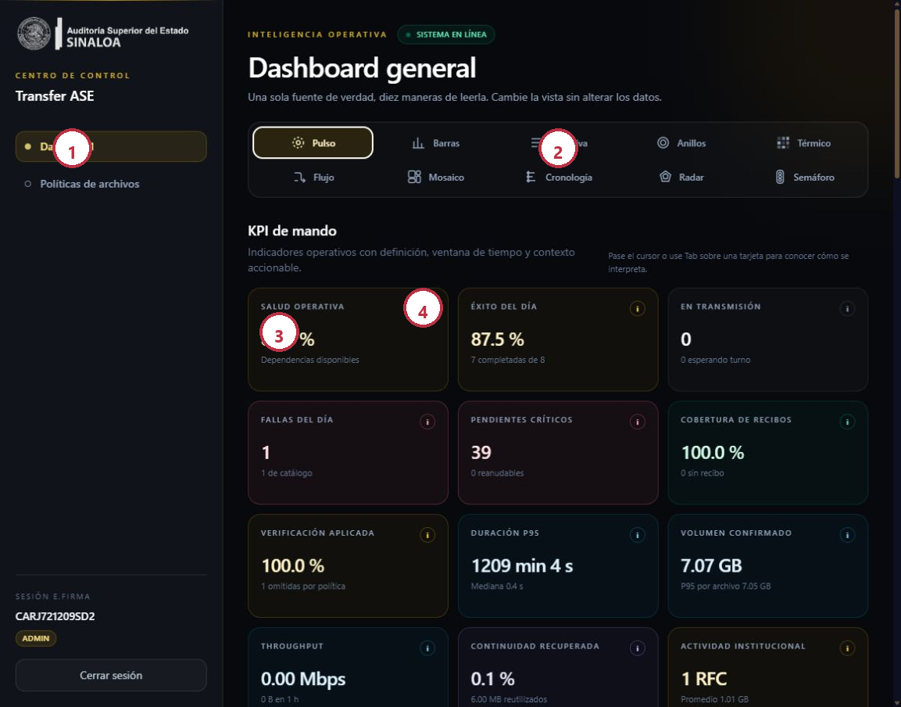
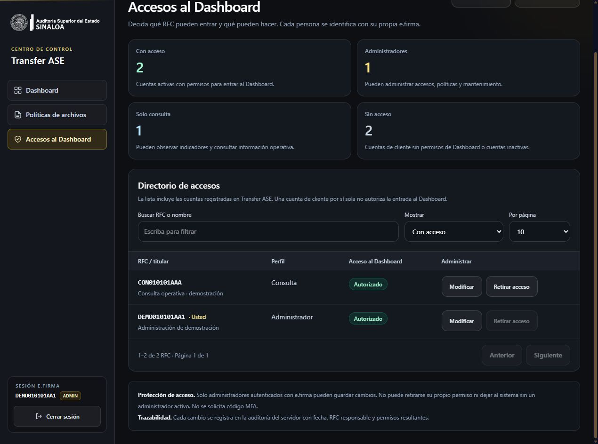
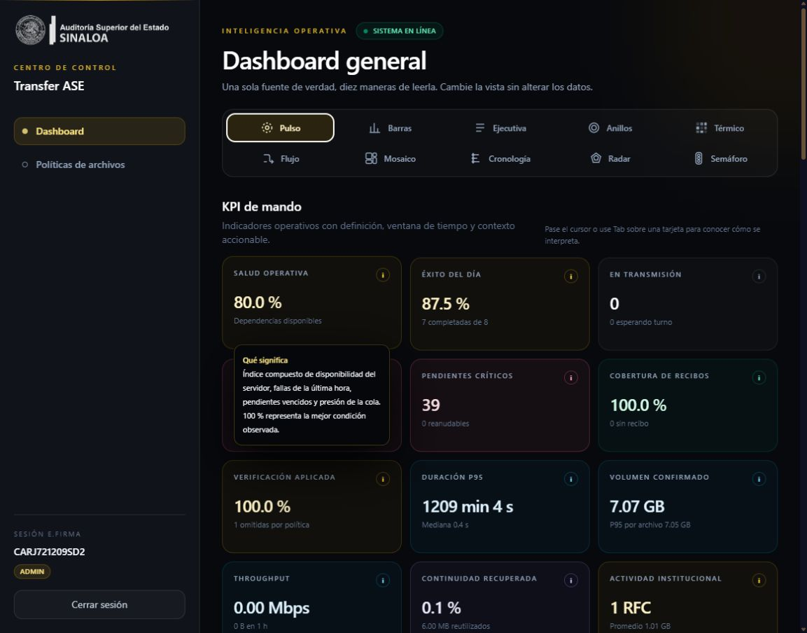
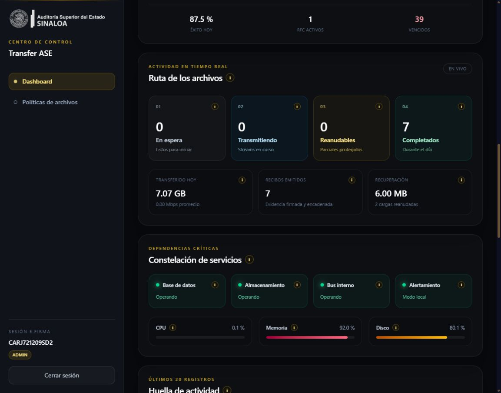
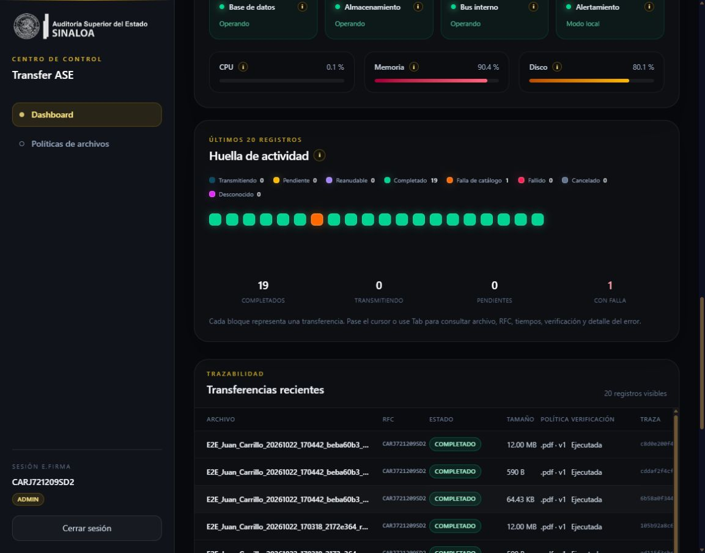
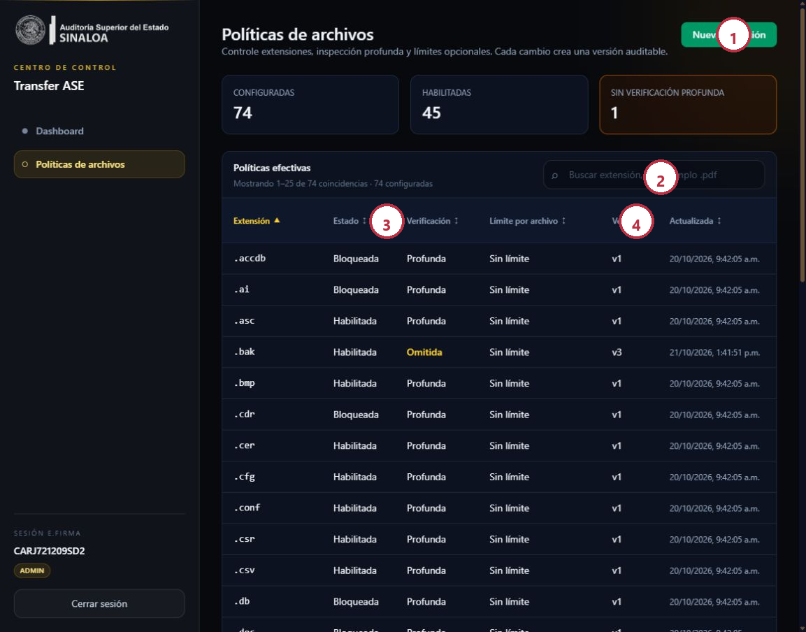
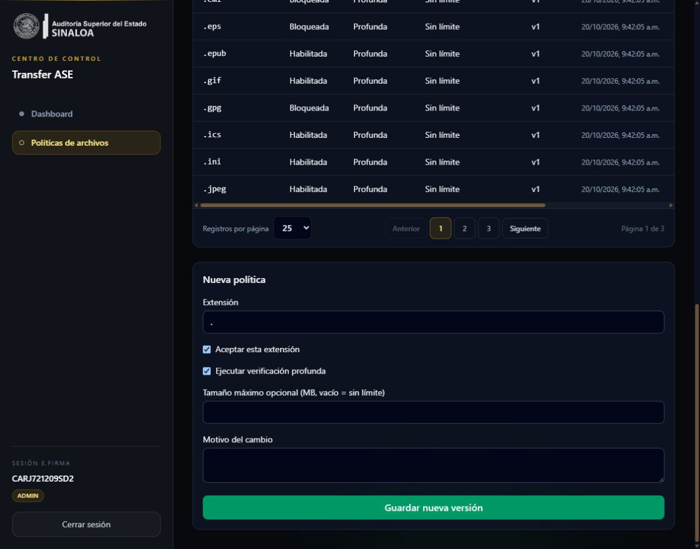

# Manual de administración del Dashboard

## Propósito y responsabilidades

El Dashboard de Transfer ASE permite observar la operación, interpretar KPI, distinguir estados, rastrear transferencias y administrar las extensiones aceptadas. No reemplaza la investigación técnica: organiza señales confiables para decidir dónde investigar primero.

### Perfiles

| Rol | Puede consultar | Puede modificar |
|---|---|---|
| `ops` (Consulta) | Dashboard, métricas, diagnósticos disponibles, transferencias y políticas | No administra accesos, políticas ni mantenimiento |
| `admin` (Administrador) | Todo lo anterior y directorio de accesos | Administra RFC, políticas, pendientes y estadísticas |

> **IMPORTANTE:** el acceso al Dashboard ocurre con e.firma antes de mostrar información. No se usa token manual ni código MFA. La sesión administrativa exige el rol asignado al RFC.

## Acceso con e.firma

1. Abra la dirección HTTPS del servidor y agregue `/admin/`.
2. Escriba el RFC autorizado.
3. Seleccione el archivo `.cer`.
4. Seleccione la llave `.key` correspondiente.
5. Escriba la contraseña de la llave privada.
6. Presione **Acceder** y espere la validación.

### Resultado esperado

La barra lateral muestra **Sesión e.firma**, el RFC y el rol. El contenido operativo solo aparece después de autenticarse.

### No use estas direcciones en el navegador

- `https://0.0.0.0:PUERTO`: es una dirección de escucha, no una dirección navegable.
- HTTP cuando el entorno exige HTTPS.
- La IP pública si el certificado TLS fue emitido únicamente para un nombre DNS distinto.

Use `https://localhost:51136/admin/` en el mismo servidor o el DNS/IP expresamente publicado y cubierto por el certificado.

## Recorrido visual del Dashboard



_Figura 1. Dashboard autenticado. Los valores son datos de desarrollo y cambian automáticamente._

1. **Navegación**: Dashboard, Políticas de archivos y, para administradores, Accesos al Dashboard.
2. **Selector de vistas**: diez representaciones de la misma información.
3. **KPI de mando**: resumen cuantitativo con ventana y contexto.
4. **Ayuda contextual**: pase el cursor o use Tab para conocer interpretación y límites.

## Administrar los RFC que pueden entrar al Dashboard

Abra **Accesos al Dashboard** en el menú lateral. Esta sección aparece únicamente para el perfil **Administrador**. Estar registrado en el cliente de Transfer ASE no otorga por sí mismo acceso al Dashboard.



_Ejemplo ilustrativo con datos sintéticos. Los contadores y registros de su servidor serán distintos._

### Autorizar una persona

1. Presione **Autorizar RFC**.
2. Escriba el RFC completo del titular, con homoclave, y presione **Consultar RFC**. No cargue archivos CER o KEY de otras personas.
3. Si el RFC ya tiene cuenta, el formulario recupera su referencia y notas. Si es nuevo, se preparará el alta sin duplicar cuentas.
4. Capture una referencia para identificarlo y seleccione **Consulta** o **Administrador**. Consulta puede observar la operación; Administrador también puede cambiar accesos, políticas y mantenimiento.
5. Si la cuenta estaba inactiva, debe marcar expresamente **Reactivar la cuenta**. Esto también permite volver a usar el cliente según sus autorizaciones en BuDi.
6. Presione **Revisar cambio**. Compruebe RFC, permiso anterior y permiso nuevo.
7. Presione **Confirmar permisos**. Espere el mensaje de resultado. El titular debe entrar con su propia e.firma para obtener los permisos actuales. No se utiliza MFA.

### Cambiar o retirar el acceso

1. Busque el RFC o nombre en el directorio. El filtro inicial muestra **Con acceso**; use **Todos los registrados**, **Sin acceso** o **Cuentas inactivas** según corresponda.
2. Presione **Modificar** para cambiar perfil, referencia o notas. Para retirar el permiso del Dashboard, presione **Retirar acceso**.
3. Revise el cambio y confirme. Cancelar no guarda nada.
4. Al retirarlo, el registro aparece como **No autorizado**. Su cuenta del cliente, archivos y autorizaciones de BuDi se conservan. Cambiar permisos invalida las sesiones anteriores tanto del Dashboard como del cliente; deberá autenticarse otra vez.
5. Para devolver el acceso, busque el RFC con **Todos los registrados** y seleccione nuevamente Consulta o Administrador.

El directorio permite 10, 25, 50 o 100 RFC por página. Los contadores representan todo el directorio, no únicamente los resultados filtrados. La lista se actualiza al entrar, al guardar y al presionar **Actualizar lista**.

### Protección y trazabilidad

- No puede retirar su propio perfil administrador ni desactivar el último administrador activo. Para un cambio en su propio perfil, debe intervenir otro administrador autorizado.
- El servidor exige e.firma y rol administrador para guardar, aunque alguien intente usar directamente la API.
- Las operaciones se registran en la auditoría del servidor (`rfc_provision_create` / `rfc_provision_update`) con fecha, RFC responsable y permisos resultantes.
- Si el registro cambió durante la edición, cierre el formulario y vuelva a abrirlo. Si aparece un error, no se presenta el cambio como exitoso.
- Las notas son referencias administrativas. No escriba contraseñas, llaves privadas ni secretos.

## Diez formas de leer la misma operación

Cambiar de vista no modifica datos ni políticas. Solo cambia la representación.

| Vista | Pregunta que responde mejor | Úsela para |
|---|---|---|
| Pulso | ¿Cómo está el sistema en conjunto? | Guardia operativa y revisión rápida |
| Barras | ¿Qué magnitudes son mayores o menores? | Comparar resultados y recursos |
| Ejecutiva | ¿Qué debe conocer una dirección en segundos? | Reporte breve y priorización |
| Anillos | ¿Qué proporción representa cada estado? | Cobertura y cumplimiento |
| Térmico | ¿Dónde se concentra la intensidad? | Detectar presión o saturación |
| Flujo | ¿En qué etapa se acumula el trabajo? | Encontrar cuellos de botella |
| Mosaico | ¿Qué prioridades requieren atención? | Clasificación visual simultánea |
| Cronología | ¿Qué ocurrió y en qué orden? | Investigación de eventos |
| Radar | ¿Qué tan equilibrados están los indicadores? | Comparar dimensiones de salud |
| Semáforo | ¿Qué requiere actuar, vigilar o continuar? | Toma de decisión inmediata |

## Interpretar los KPI



_Figura 2. La ayuda contextual tiene fondo opaco para mantener la legibilidad._

| KPI | Significado operativo | Señal de atención |
|---|---|---|
| Salud operativa | Índice explicado de dependencias, fallas técnicas e inactividad/vencimiento | Cada descuento incluye su causa y una acción |
| Éxito del día | Completadas / (completadas + fallas técnicas y rechazos) | Cancelaciones administrativas y expiraciones se muestran aparte |
| En transmisión | Sesiones enviando bytes y esperando turno | Crece sin avance o se mantiene después de terminar |
| Fallas del día | Cierres no exitosos, incluida falla de catálogo | Cualquier crecimiento sostenido |
| Pendientes sin actividad | Más de 30 minutos sin actividad, sin sesión activa, aún dentro de plazo | Contactar al usuario y reanudar o retirar si se abandonó |
| Cobertura de recibos | Completadas con recibo digital | Menor a 100 % requiere investigación |
| Verificación aplicada | Archivos obligados que sí se verificaron | Omisiones no explicadas por política |
| Duración P95 | Tiempo bajo el cual termina 95 % de cargas | Aumento abrupto frente a la mediana |
| Volumen confirmado | Bytes completados del día y P95 por archivo | Crecimiento sin capacidad equivalente |
| Throughput | Promedio efectivo de bytes confirmados en una hora | Cero con transmisiones activas |
| Continuidad recuperada | Bytes reutilizados por reanudación | Cero después de cortes conocidos |
| Actividad institucional | RFC distintos con actividad | Cambios no esperados en el patrón |
| Pendientes persistentes | Cargas Pending/Paused que siguen registradas aunque reinicie el servidor | Diferenciar del número de conexiones en memoria |
| Vencidos por limpiar | Pendientes inactivos que alcanzaron su vencimiento individual | Limpiar vencidos o revisar permisos si persisten |
| Vencen en 24 horas | Pendientes inactivos con plazo próximo, todavía vigente | Avisar al usuario antes de perder la oportunidad de reanudar |
| Espacio en parciales | Bytes recibidos asociados al backlog pendiente | Revisar capacidad y limpiar cargas abandonadas |
| Antigüedad sin actividad | Horas desde la última actividad del pendiente inactivo más viejo | Priorizar el archivo más abandonado |
| Bytes próximos a vencer | Bytes de parciales que vencen dentro de las siguientes 24 horas | Medir cuánto trabajo se perdería si no se reanuda |
| Cancelaciones / expiraciones | Cierres administrativos y por plazo, separados de fallas técnicas | Detectar abandono sin distorsionar la tasa de éxito técnico |

### Salud operativa: cálculo y saneamiento

El valor inicia en **100 puntos** y descuenta los cuatro factores siguientes. El panel **Salud operativa: causas y recuperación** muestra el descuento exacto y el remedio para cada uno.

| Factor | Descuento | Cómo recuperarlo |
|---|---|---|
| Dependencias degradadas | 25 si alguna dependencia observada falla | Revisar `/readyz`, SQL, ruta de almacenamiento, permisos de la cuenta del servicio y SMTP/outbox |
| Fallas técnicas en 60 minutos | 0.6 puntos por cada 1 % de fallas; máximo 30 | Revisar error y TraceId, resolver su causa; la ventana se actualiza con el tiempo y los cierres exitosos |
| Pendientes inactivos | 5 por archivo sin actividad durante 30 minutos, aún vigente; máximo 20 | Pedir al usuario reanudar o retirar si abandonó el envío |
| Pendientes vencidos | 3 por archivo inactivo fuera de su plazo; máximo 15 | Ejecutar Limpiar vencidos o esperar el siguiente ciclo; si falla, revisar permisos y almacenamiento |

`Salud = máximo(0, 100 − suma de descuentos)`.

Las transferencias activas normales no reducen la salud. Un archivo viejo que sigue transfiriéndose tampoco se considera abandonado. Los vencidos se cuentan en su factor propio para evitar descontarlos también como inactivos. CPU, memoria y disco se muestran como señales separadas: no forman parte de esta fórmula.

Sanear significa resolver la causa y comprobar el siguiente corte. Reiniciar estadísticas no restaura artificialmente la salud; la salud siempre considera la última hora real y todos los pendientes existentes.

### Eliminar pendientes manualmente

Solo el rol **admin**, autenticado con e.firma, puede realizar estas operaciones. `ops` puede consultar los pendientes.

1. Abra el panel de **Pendientes y mantenimiento**.
2. Busque el archivo por nombre/RFC y revise tamaño, última actividad y vencimiento. Use la paginación para recorrer la lista.
3. Seleccione los archivos abandonados. Una transferencia activa no puede seleccionarse; el servidor también vuelve a comprobarlo al ejecutar.
4. Presione el botón de eliminación de seleccionados.
5. Escriba un motivo de entre 5 y 500 caracteres y confirme.
6. Revise el resultado: eliminados, omitidos y errores. Un archivo que terminó o volvió a activarse durante la operación se omite.

Se elimina una copia parcial exclusiva y la transferencia deja de estar pendiente. Si el archivo tiene referencias compartidas, se cierra únicamente el pendiente y se conserva el archivo físico. Se conserva el estado terminal, su responsable, el motivo y la auditoría. No se eliminan documentos completados ni sus recibos. Para enviar otra vez un archivo retirado, el usuario debe iniciar una transferencia nueva.

El resultado permanece visible después de cerrar la confirmación: cada archivo informa si se eliminó su copia, se cerró el registro conservando el archivo, se omitió o falló. Una operación sin cambios se muestra como advertencia con la causa por archivo; no debe interpretarse como una limpieza exitosa.

### Expiración automática y Limpiar vencidos

El servicio revisa al iniciar y **cada minuto** el plazo individual `ResumeExpiresUtc`. Para registros antiguos sin esa fecha, calcula el límite como última actividad + `Storage:ResumeRetentionHours` (24 horas por defecto; se respeta la configuración instalada). Si tampoco existe actividad válida, utiliza la creación.

Una copia parcial exclusiva, vencida e inactiva se elimina y queda marcada `Expired` con auditoría. Si su ruta está compartida con otros registros, se marca la transferencia como vencida conservando el archivo; los bytes liberados son cero y el resultado lo indica. Se comprueba también que ninguna transferencia que referencia el archivo esté activa. El botón **Limpiar vencidas ahora** adelanta el mismo proceso. Cada pase trabaja hasta 1000 candidatos; una cola mayor se vacía en ciclos sucesivos. Los archivos activos y los registros con evidencia protegida se omiten. Si falla el borrado, se conserva el pendiente para poder reintentar y consultar el motivo en el resultado.

El plazo se comprueba también al solicitar la reanudación: un archivo vencido no se revive durante el intervalo anterior al siguiente ciclo de limpieza.

### Conciliar pendientes protegidos

Una ruta registrada que no corresponde al contexto actual requiere una decisión explícita. El sistema muestra la causa junto al archivo y habilita **Conciliar seleccionadas** cuando se puede cerrar el registro de forma segura.

1. Desde el diagnóstico de salud, presione la acción para revisar los pendientes protegidos.
2. Revise la causa específica de cada fila y seleccione los registros abandonados.
3. Presione **Conciliar seleccionadas**, indique el motivo y confirme el alcance: se cerrará el pendiente conservando el archivo físico.
4. Compruebe los resultados individuales y el siguiente corte de salud.

Conciliar no cambia rutas, no declara un documento recibido y no sustituye un recibo. Las transferencias activas y la evidencia de recepción permanecen protegidas. El historial conserva el cierre y la decisión del administrador.

### Comprobar el almacenamiento desde el Dashboard

El indicador de almacenamiento realiza una prueba de **escritura, lectura y eliminación** bajo la cuenta del servicio, usando únicamente un archivo propio aleatorio de 32 bytes. El panel muestra ruta, cuenta, fecha de comprobación, operación que falló, código y recomendación específica.

Use **Comprobar almacenamiento ahora** para repetir la prueba después de corregir red, ruta o permisos. Esta acción no concede permisos, no cambia credenciales y no modifica documentos del usuario.

La capacidad de una carpeta de red se consulta con la operación de Windows apropiada para rutas UNC. Si no se puede medir el espacio pero la prueba funcional es correcta, el panel indica **Sin medición**: la falta de telemetría de capacidad no debe marcar como caído un almacenamiento que sí funciona.

### Reiniciar estadísticas

1. Presione **Reiniciar estadísticas** con sesión `admin`.
2. Revise el alcance del mensaje, escriba un motivo y confirme.
3. El Dashboard muestra la fecha del nuevo corte; completadas, fallas, volumen y tasas empiezan a medirse desde él.

El corte se guarda en SQL como evento de auditoría y sobrevive al reinicio del servicio. No vacía tablas de transferencias, archivos ni recibos. Los KPI diarios usan el día de **America/Mazatlan** o el nuevo corte si es posterior; los horarios se almacenan en UTC y se presentan en la zona del navegador. Salud, pendientes y recursos siguen mostrando su estado real. Los contadores internos de alertas siguen el período de su propia fuente y no se borran mediante este botón.

Sin cierres observados, una tasa de cero no significa falla: no existe todavía muestra suficiente. Interprete tasas junto al número de archivos.

### Cómo usar la ayuda detallada

- Pase el cursor sobre una tarjeta o enfoque con **Tab**.
- Lea **Qué significa**, la ventana temporal y la acción sugerida.
- En **Estado compuesto**, **Ruta de archivos**, **Dependencias críticas** y cada recurso también existe ayuda contextual.
- Un color no sustituye el texto: confirme siempre el nombre del estado.

## Ruta de archivos y dependencias



_Figura 3. El flujo separa espera, transmisión, reanudación y cierre; las dependencias explican capacidad real de operación._

### Estados del flujo

| Estado | Color orientativo | Interpretación |
|---|---|---|
| En espera | Gris | Admitido y listo para iniciar |
| Transmitiendo | Azul | Envía bytes en este momento |
| Reanudable | Ámbar | Tiene parcial protegido y puede continuar |
| Completado | Verde | Bytes, hash, catálogo y recibo confirmados |
| Falla de catálogo | Naranja | Archivo persistido pero registro de negocio no cerró |
| Fallido | Rojo/rosa | Operación no completada |
| Cancelado | Gris oscuro | Cancelación explícita |
| Desconocido | Magenta | Estado no clasificado; requiere revisión |

### Dependencias críticas

- **Base de datos**: FileXferDb disponible y esquema vigente.
- **Almacenamiento**: ruta accesible, espacio y permisos de la cuenta de servicio.
- **Bus interno**: cola interna de trabajo en operación.
- **Alertamiento**: outbox y entrega externa; “modo local” significa que no hay canal externo activo.
- **CPU, memoria y disco**: presión del servidor; evalúe tendencia, no solo una lectura aislada.

> **IMPORTANTE:** `/healthz` prueba que el proceso vive; `/readyz` prueba que puede prestar el servicio con sus dependencias. Un proceso vivo con SQL caído no está listo.

## Huella de actividad y trazabilidad



_Figura 4. Cada bloque usa el color del estado y muestra detalle al pasar el cursor._

### Qué debe revisar al investigar una transferencia

1. Nombre del archivo y RFC.
2. Estado traducido, no el valor interno en inglés.
3. Tamaño y hora de creación/cierre.
4. Extensión y versión de política aplicada.
5. Verificación ejecutada u omitida.
6. `TraceId` para correlacionar logs.
7. `ReceiptId` para confirmar evidencia digital.
8. Detalle de error en un bloque fallido.

### Diferencia entre completado y falla de catálogo

**Completado** implica cierre técnico y de negocio. **Falla de catálogo** significa que el archivo pudo llegar al almacenamiento, pero la relación con BuDi no se confirmó. No reenvíe a ciegas: use la recuperación idempotente para evitar duplicados.

## Administrar políticas de archivos



_Figura 5. La búsqueda, orden y paginación no modifican políticas; solo cambian la vista._

1. **Nueva extensión**: abre el formulario para crear la primera versión.
2. **Buscar por extensión**: acepta texto como `.pdf`, `pdf` o una fracción.
3. **Ordenar**: haga clic en cualquier encabezado ordenable; el indicador muestra dirección.
4. **Límite por archivo**: “Sin límite” significa que la política no impone un máximo explícito.

### Paginación

- Seleccione 10, 25, 50 o 100 registros por página.
- Use **Anterior**, número de página o **Siguiente**.
- La pantalla muestra rango visible, coincidencias y total configurado.
- Cambiar búsqueda, orden o tamaño devuelve a una página válida.

### Crear una política



_Figura 6. Cada alta crea una versión auditable y exige un motivo._

1. Presione **Nueva extensión**.
2. Escriba la extensión con punto, por ejemplo `.pdf`.
3. Active **Aceptar esta extensión** solo si debe permitirse.
4. Mantenga **Ejecutar verificación profunda** salvo excepción formal.
5. Deje vacío el tamaño máximo para **sin límite** o escriba MB cuando exista restricción.
6. Describa el motivo con suficiente detalle para una auditoría.
7. Presione **Guardar nueva versión**.
8. Confirme el mensaje y busque la extensión en el grid.

### Editar una política

1. Busque la extensión.
2. Presione **Editar**.
3. Revise la versión actual y su historial.
4. Cambie solo los campos autorizados.
5. Escriba el motivo.
6. Guarde; nunca se sobrescribe silenciosamente una versión concurrente.

Si otro administrador modificó la misma política, el servidor responde con conflicto. Recargue y vuelva a evaluar; no intente forzar el valor anterior.

### Rollback

1. Abra **Editar** en la extensión.
2. Revise **Historial y rollback**.
3. Identifique una versión anterior conocida.
4. Presione **Restaurar esta configuración**.
5. Escriba el motivo del rollback.
6. El sistema crea una nueva versión efectiva; no borra el historial.

## Decidir si omitir verificación profunda

La omisión reduce garantías y debe ser excepcional.

| Decisión | Beneficio | Riesgo |
|---|---|---|
| Verificación profunda activa | Demuestra estructura, cifrado y controles específicos | Consume CPU y tiempo de inspección |
| Verificación profunda omitida | Permite formatos sin validador completo o reduce tiempo | No demuestra ausencia de contraseña, daño o contenido activo |
| Extensión bloqueada | Evita aceptar un riesgo no controlado | Obliga a convertir o cambiar el canal |

> **NO DESACTIVE** la verificación solo para hacer desaparecer un error. Primero determine si el formato es verificable, si existe una alternativa segura y quién acepta el riesgo residual.

## Respuesta operativa por escenario

### Acceso que muestra login y después una pantalla negra

Abra **https://187.141.128.194:51136/admin/**. La barra final identifica la página principal.
Desde la corrección 2.2.1.10, el servidor también admite `/admin` y lo dirige automáticamente a `/admin/`,
conservando los parámetros de la liga. El Dashboard reconoce ambas variantes después del inicio de sesión.

Si tiene abierta una pestaña anterior a la actualización, presione **Ctrl + F5** y vuelva a entrar con su e.firma
si la sesión venció. No necesita instalar un cliente ni cambiar los permisos de su cuenta.

Si aparece **No se pudo mostrar el Dashboard**, presione **Volver a intentar**. Si el problema continúa,
use **Abrir página principal** e informe a soporte la hora y la acción previa. No envíe su KEY ni contraseña.
Una dirección de sección desconocida muestra **Esta sección no existe**, con un enlace **Volver al Dashboard**.
Estas acciones de recuperación no eliminan archivos ni reinician estadísticas.

| Escenario | Acción inmediata | Evidencia a conservar |
|---|---|---|
| `/readyz` en error | Detener nuevas cargas o drenar | Respuesta, hora, dependencias y logs |
| Falla de catálogo | No duplicar manualmente | TraceId, archivo, RFC y requerimiento |
| Recibo faltante | Investigar persistencia/firma | UploadId, TraceId y estado de llave |
| Memoria o disco en rojo | Reducir admisión y revisar capacidad | Tendencia, espacio, cargas grandes |
| Pendientes críticos crecen | Revisar red, cuotas y checkpoints | Edad, estado, offset y RFC |
| Omitidas por política aumentan | Revisar cambios administrativos | Extensión, versión, motivo y responsable |
| Dead-letter de alertas | Resolver canal y reintentar controladamente | Evento, intentos y error externo |

## Cierre de sesión y seguridad

### Permisos de Solo consulta

El rol **Solo consulta** (`ops`) puede buscar, ordenar, paginar y leer datos. Estas acciones cambian la presentación de su pantalla, no la configuración del sistema.

| Acción | Solo consulta | Administrador |
|---|---|---|
| Leer indicadores, alertas, políticas e historial | Sí | Sí |
| Cambiar una extensión, su aceptación, límite o verificación | No | Sí, con motivo |
| Crear una política o restaurar una versión anterior | No | Sí, con motivo |
| Retirar/conciliar pendientes o limpiar vencidos | No | Sí, con motivo |
| Reiniciar estadísticas | No | Sí, con motivo |
| Ejecutar una comprobación de escritura del almacenamiento | No | Sí |
| Administrar el directorio de RFC y sus permisos | No | Sí |

En **Políticas de archivos**, Solo consulta verá **Ver detalle**, campos deshabilitados y el historial sin botones de restauración. El servidor también rechaza las operaciones de escritura: ocultar botones no sustituye la autorización.

### Identificar una alerta que agotó los intentos

1. Entre en **Dashboard → Diagnóstico**.
2. Busque **Entrega de alertas**, debajo del diagnóstico de salud y almacenamiento.
3. El filtro inicial es **Intentos agotados**. Puede cambiarlo a pendientes, en entrega, entregadas o todos, y elegir 10, 25, 50 o 100 avisos por página.
4. Cada tarjeta muestra el evento, canal afectado, intentos fallidos acumulados, límite actual, RFC, fecha, código de error y cómo corregirlo.
5. Si el aviso pertenece a un archivo, verá su nombre y, al abrir **Identificadores para seguimiento**, su ID de catálogo y traza. Los registros antiguos intentan recuperar el nombre desde BuDi; si ya no está disponible conservan el ID.
6. Si el aviso corresponde a **Login SAT fallido**, puede indicar **sin archivo asociado**. En ese caso falló la notificación de un acceso rechazado; no significa que una subida agotó reintentos ni que se perdió un archivo.
7. Use **Actualizar alertas** para consultar de inmediato. La sección también consulta cada 15 segundos mientras está abierta.

| Lo que ve | Qué significa | Qué hacer |
|---|---|---|
| Webhook sin configurar | No existe ese canal en este ambiente | No atribuya a webhook un fallo que ocurrió en SMTP |
| Intentos agotados / DeadLetter | El aviso ya no se vuelve a enviar automáticamente | Corregir el canal y solicitar a soporte un reproceso controlado por ID de evento |
| Host de ejemplo | SMTP sigue usando una configuración inicial | Configurar el servidor de correo real |
| Error de autenticación | El servidor de correo rechazó credenciales o permisos | Verificar cuenta, contraseña y permisos de envío con el administrador |
| Error TLS | No se validó una conexión cifrada al destino | Revisar certificado, nombre y puerto; mantener la validación de certificados |
| `SmtpException` en un registro antiguo | El historial guardó un código genérico | Revisar configuración; el sistema no inventa una causa que no se registró |

**La salud sigue mostrando una advertencia mientras haya avisos agotados pendientes de atención.** Corregir la contraseña no reenvía esas filas antiguas. Reiniciar estadísticas tampoco entrega mensajes ni borra esta evidencia.

### Reiniciar correctamente el período de estadísticas

Un administrador entra en **Mantenimiento → Reiniciar estadísticas…**, escribe un motivo de 5 a 500 caracteres y confirma. Verá la nueva fecha de inicio. Desde el servidor 2.2.1.11 se corrige la validación que podía responder HTTP 500 antes de procesar el motivo.

El reinicio no elimina archivos, recibos, auditoría ni alertas. Los pendientes y la salud siguen usando el estado real. Si la operación falla, conserve la hora y el mensaje mostrado; no repita envíos de archivos para corregir una estadística.

### Activar el correo institucional en el servidor de pruebas

El responsable del servidor abre **PowerShell 7 como administrador** en SERVERDIG1, después de publicar el servidor 2.2.1.11, y ejecuta el script del paquete de despliegue:

```powershell
& 'D:\Releases\TransferASE\2.2.1.11\deployment\Configure-FileXferSmtp.ps1'
```

Los valores preparados son `mail.ase-sinaloa.gob.mx:465`, cuenta/remitente/destinatario `juan.carrillo@ase-sinaloa.gob.mx`. Capture la contraseña cuando se solicite: no la escriba en un comando, chat o ticket. El script prueba cifrado y autenticación sin enviar mensajes, guarda la configuración local con permisos restringidos y reinicia únicamente `FileXferPruebas.Server`. Necesita volver a comprobar la entrega con una alerta autorizada; autenticarse en SMTP no prueba por sí solo que un correo llegó al buzón.

La herramienta no reenvía automáticamente los eventos agotados. Para esos avisos, conserve el ID y coordine con soporte el reproceso. La configuración local contiene el secreto protegido por permisos Windows, no cifrado en reposo, y debe permanecer fuera del repositorio.

- Presione **Cerrar sesión** al terminar.
- No comparta el equipo con una sesión administrativa abierta.
- No pegue tokens en la URL, consola o capturas.
- No copie CER, KEY o contraseñas a tickets.
- Use el `TraceId` y `ReceiptId` para soporte; existen precisamente para evitar la arqueología por intuición.

## Lista de verificación diaria

- El indicador superior dice **Sistema en línea**.
- `/readyz` está en 200.
- Base de datos y almacenamiento están operando.
- No hay crecimiento injustificado de fallas o pendientes críticos.
- Cobertura de recibos es 100 % o existe incidente documentado.
- Las omisiones de verificación corresponden a políticas aprobadas.
- Espacio de disco y memoria están dentro del umbral operativo.
- Las alertas externas no tienen dead-letter pendiente.
