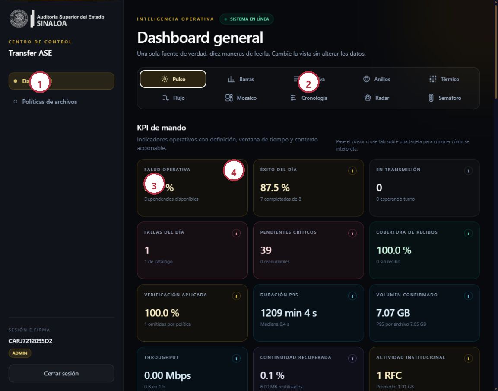
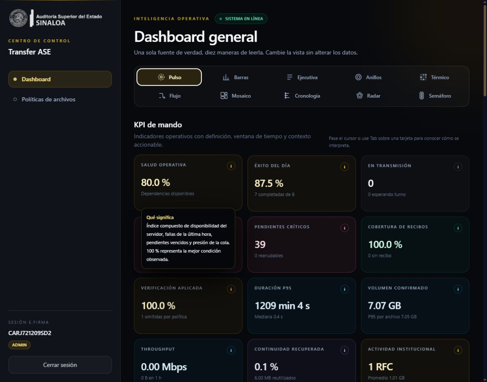
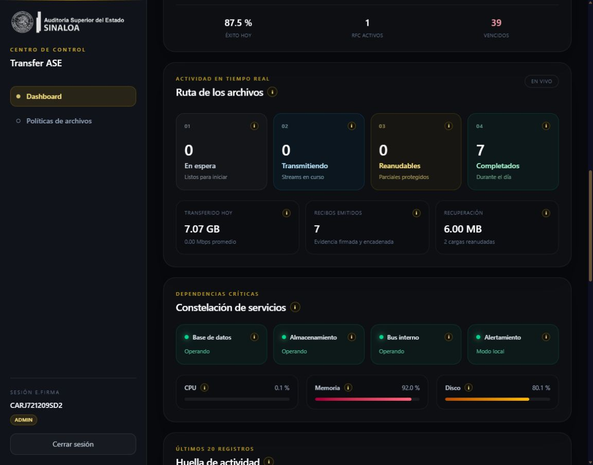
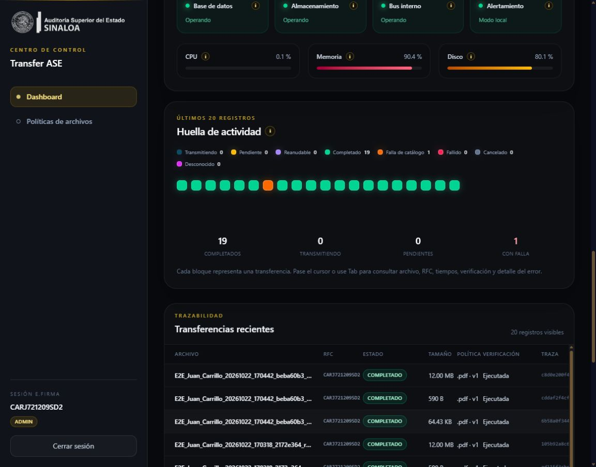
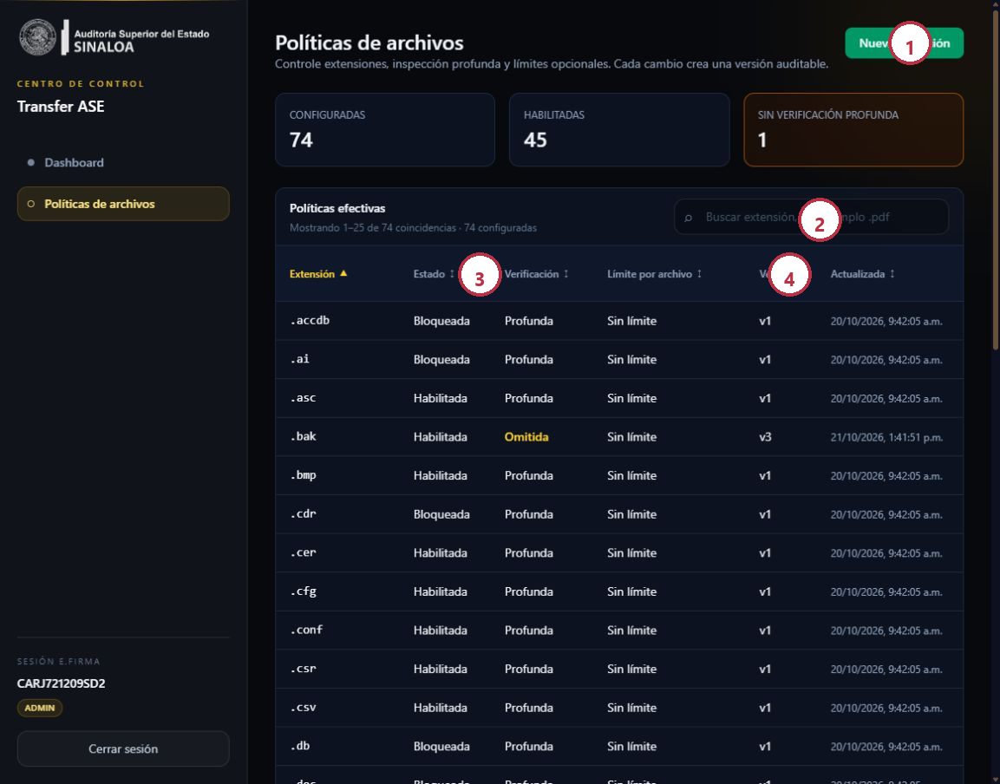
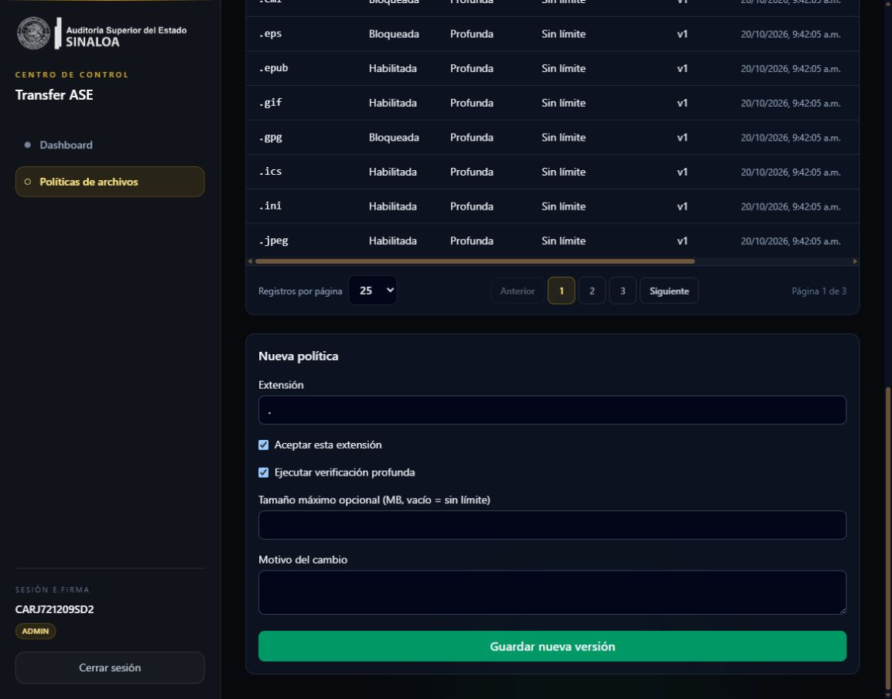

# Manual de administración del Dashboard

## Propósito y responsabilidades

El Dashboard de Transfer ASE permite observar la operación, interpretar KPI, distinguir estados, rastrear transferencias y administrar las extensiones aceptadas. No reemplaza la investigación técnica: organiza señales confiables para decidir dónde investigar primero.

### Perfiles

| Rol | Puede consultar | Puede modificar |
|---|---|---|
| `ops` | Dashboard, métricas, dependencias, transferencias y políticas | No cambia políticas |
| `admin` | Todo lo anterior | Crea versiones de políticas y ejecuta rollback |

> **IMPORTANTE:** el acceso al Dashboard ocurre con e.firma antes de mostrar información. No se usa token manual ni código MFA. La sesión administrativa exige el rol asignado al RFC.

## Acceso con e.firma

1. Abra la dirección HTTPS del servidor y agregue `/admin/`.
2. Escriba el RFC autorizado.
3. Seleccione el archivo `.cer`.
4. Seleccione la llave `.key` correspondiente.
5. Escriba la contraseña de la llave privada.
6. Presione **Acceder** y espere la validación.

### Resultado esperado

La barra lateral muestra **Sesión e.firma**, el RFC y el rol. El contenido operativo solo aparece después de autenticarse.

### No use estas direcciones en el navegador

- `https://0.0.0.0:PUERTO`: es una dirección de escucha, no una dirección navegable.
- HTTP cuando el entorno exige HTTPS.
- La IP pública si el certificado TLS fue emitido únicamente para un nombre DNS distinto.

Use `https://localhost:51136/admin/` en el mismo servidor o el DNS/IP expresamente publicado y cubierto por el certificado.

## Recorrido visual del Dashboard

_Figura 1. Dashboard autenticado. Los valores son datos de desarrollo y cambian automáticamente._

1. **Navegación**: Dashboard y Políticas de archivos.
2. **Selector de vistas**: diez representaciones de la misma información.
3. **KPI de mando**: resumen cuantitativo con ventana y contexto.
4. **Ayuda contextual**: pase el cursor o use Tab para conocer interpretación y límites.

## Diez formas de leer la misma operación

Cambiar de vista no modifica datos ni políticas. Solo cambia la representación.

| Vista | Pregunta que responde mejor | Úsela para |
|---|---|---|
| Pulso | ¿Cómo está el sistema en conjunto? | Guardia operativa y revisión rápida |
| Barras | ¿Qué magnitudes son mayores o menores? | Comparar resultados y recursos |
| Ejecutiva | ¿Qué debe conocer una dirección en segundos? | Reporte breve y priorización |
| Anillos | ¿Qué proporción representa cada estado? | Cobertura y cumplimiento |
| Térmico | ¿Dónde se concentra la intensidad? | Detectar presión o saturación |
| Flujo | ¿En qué etapa se acumula el trabajo? | Encontrar cuellos de botella |
| Mosaico | ¿Qué prioridades requieren atención? | Clasificación visual simultánea |
| Cronología | ¿Qué ocurrió y en qué orden? | Investigación de eventos |
| Radar | ¿Qué tan equilibrados están los indicadores? | Comparar dimensiones de salud |
| Semáforo | ¿Qué requiere actuar, vigilar o continuar? | Toma de decisión inmediata |

## Interpretar los KPI

_Figura 2. La ayuda contextual tiene fondo opaco para mantener la legibilidad._

| KPI | Significado operativo | Señal de atención |
|---|---|---|
| Salud operativa | Índice compuesto de disponibilidad, fallas, vencidos y cola | Desciende aunque el proceso siga vivo |
| Éxito del día | Completadas respecto de cierres del día | Cae por fallas, rechazos, cancelaciones o expiraciones |
| En transmisión | Sesiones enviando bytes y esperando turno | Crece sin avance o se mantiene después de terminar |
| Fallas del día | Cierres no exitosos, incluida falla de catálogo | Cualquier crecimiento sostenido |
| Pendientes críticos | Pendientes de más de 30 minutos | Número alto o reanudables envejecidos |
| Cobertura de recibos | Completadas con recibo digital | Menor a 100 % requiere investigación |
| Verificación aplicada | Archivos obligados que sí se verificaron | Omisiones no explicadas por política |
| Duración P95 | Tiempo bajo el cual termina 95 % de cargas | Aumento abrupto frente a la mediana |
| Volumen confirmado | Bytes completados del día y P95 por archivo | Crecimiento sin capacidad equivalente |
| Throughput | Promedio efectivo de bytes confirmados en una hora | Cero con transmisiones activas |
| Continuidad recuperada | Bytes reutilizados por reanudación | Cero después de cortes conocidos |
| Actividad institucional | RFC distintos con actividad | Cambios no esperados en el patrón |

### Cómo usar la ayuda detallada

- Pase el cursor sobre una tarjeta o enfoque con **Tab**.
- Lea **Qué significa**, la ventana temporal y la acción sugerida.
- En **Estado compuesto**, **Ruta de archivos**, **Dependencias críticas** y cada recurso también existe ayuda contextual.
- Un color no sustituye el texto: confirme siempre el nombre del estado.

## Ruta de archivos y dependencias

_Figura 3. El flujo separa espera, transmisión, reanudación y cierre; las dependencias explican capacidad real de operación._

### Estados del flujo

| Estado | Color orientativo | Interpretación |
|---|---|---|
| En espera | Gris | Admitido y listo para iniciar |
| Transmitiendo | Azul | Envía bytes en este momento |
| Reanudable | Ámbar | Tiene parcial protegido y puede continuar |
| Completado | Verde | Bytes, hash, catálogo y recibo confirmados |
| Falla de catálogo | Naranja | Archivo persistido pero registro de negocio no cerró |
| Fallido | Rojo/rosa | Operación no completada |
| Cancelado | Gris oscuro | Cancelación explícita |
| Desconocido | Magenta | Estado no clasificado; requiere revisión |

### Dependencias críticas

- **Base de datos**: FileXferDb disponible y esquema vigente.
- **Almacenamiento**: ruta accesible, espacio y permisos de la cuenta de servicio.
- **Bus interno**: cola interna de trabajo en operación.
- **Alertamiento**: outbox y entrega externa; “modo local” significa que no hay canal externo activo.
- **CPU, memoria y disco**: presión del servidor; evalúe tendencia, no solo una lectura aislada.

> **IMPORTANTE:** `/healthz` prueba que el proceso vive; `/readyz` prueba que puede prestar el servicio con sus dependencias. Un proceso vivo con SQL caído no está listo.

## Huella de actividad y trazabilidad

_Figura 4. Cada bloque usa el color del estado y muestra detalle al pasar el cursor._

### Qué debe revisar al investigar una transferencia

1. Nombre del archivo y RFC.
2. Estado traducido, no el valor interno en inglés.
3. Tamaño y hora de creación/cierre.
4. Extensión y versión de política aplicada.
5. Verificación ejecutada u omitida.
6. `TraceId` para correlacionar logs.
7. `ReceiptId` para confirmar evidencia digital.
8. Detalle de error en un bloque fallido.

### Diferencia entre completado y falla de catálogo

**Completado** implica cierre técnico y de negocio. **Falla de catálogo** significa que el archivo pudo llegar al almacenamiento, pero la relación con BuDi no se confirmó. No reenvíe a ciegas: use la recuperación idempotente para evitar duplicados.

## Administrar políticas de archivos

_Figura 5. La búsqueda, orden y paginación no modifican políticas; solo cambian la vista._

1. **Nueva extensión**: abre el formulario para crear la primera versión.
2. **Buscar por extensión**: acepta texto como `.pdf`, `pdf` o una fracción.
3. **Ordenar**: haga clic en cualquier encabezado ordenable; el indicador muestra dirección.
4. **Límite por archivo**: “Sin límite” significa que la política no impone un máximo explícito.

### Paginación

- Seleccione 10, 25, 50 o 100 registros por página.
- Use **Anterior**, número de página o **Siguiente**.
- La pantalla muestra rango visible, coincidencias y total configurado.
- Cambiar búsqueda, orden o tamaño devuelve a una página válida.

### Crear una política

_Figura 6. Cada alta crea una versión auditable y exige un motivo._

1. Presione **Nueva extensión**.
2. Escriba la extensión con punto, por ejemplo `.pdf`.
3. Active **Aceptar esta extensión** solo si debe permitirse.
4. Mantenga **Ejecutar verificación profunda** salvo excepción formal.
5. Deje vacío el tamaño máximo para **sin límite** o escriba MB cuando exista restricción.
6. Describa el motivo con suficiente detalle para una auditoría.
7. Presione **Guardar nueva versión**.
8. Confirme el mensaje y busque la extensión en el grid.

### Editar una política

1. Busque la extensión.
2. Presione **Editar**.
3. Revise la versión actual y su historial.
4. Cambie solo los campos autorizados.
5. Escriba el motivo.
6. Guarde; nunca se sobrescribe silenciosamente una versión concurrente.

Si otro administrador modificó la misma política, el servidor responde con conflicto. Recargue y vuelva a evaluar; no intente forzar el valor anterior.

### Rollback

1. Abra **Editar** en la extensión.
2. Revise **Historial y rollback**.
3. Identifique una versión anterior conocida.
4. Presione **Restaurar esta configuración**.
5. Escriba el motivo del rollback.
6. El sistema crea una nueva versión efectiva; no borra el historial.

## Decidir si omitir verificación profunda

La omisión reduce garantías y debe ser excepcional.

| Decisión | Beneficio | Riesgo |
|---|---|---|
| Verificación profunda activa | Demuestra estructura, cifrado y controles específicos | Consume CPU y tiempo de inspección |
| Verificación profunda omitida | Permite formatos sin validador completo o reduce tiempo | No demuestra ausencia de contraseña, daño o contenido activo |
| Extensión bloqueada | Evita aceptar un riesgo no controlado | Obliga a convertir o cambiar el canal |

> **NO DESACTIVE** la verificación solo para hacer desaparecer un error. Primero determine si el formato es verificable, si existe una alternativa segura y quién acepta el riesgo residual.

## Respuesta operativa por escenario

| Escenario | Acción inmediata | Evidencia a conservar |
|---|---|---|
| `/readyz` en error | Detener nuevas cargas o drenar | Respuesta, hora, dependencias y logs |
| Falla de catálogo | No duplicar manualmente | TraceId, archivo, RFC y requerimiento |
| Recibo faltante | Investigar persistencia/firma | UploadId, TraceId y estado de llave |
| Memoria o disco en rojo | Reducir admisión y revisar capacidad | Tendencia, espacio, cargas grandes |
| Pendientes críticos crecen | Revisar red, cuotas y checkpoints | Edad, estado, offset y RFC |
| Omitidas por política aumentan | Revisar cambios administrativos | Extensión, versión, motivo y responsable |
| Dead-letter de alertas | Resolver canal y reintentar controladamente | Evento, intentos y error externo |

## Cierre de sesión y seguridad

- Presione **Cerrar sesión** al terminar.
- No comparta el equipo con una sesión administrativa abierta.
- No pegue tokens en la URL, consola o capturas.
- No copie CER, KEY o contraseñas a tickets.
- Use el `TraceId` y `ReceiptId` para soporte; existen precisamente para evitar la arqueología por intuición.

## Lista de verificación diaria

- El indicador superior dice **Sistema en línea**.
- `/readyz` está en 200.
- Base de datos y almacenamiento están operando.
- No hay crecimiento injustificado de fallas o pendientes críticos.
- Cobertura de recibos es 100 % o existe incidente documentado.
- Las omisiones de verificación corresponden a políticas aprobadas.
- Espacio de disco y memoria están dentro del umbral operativo.
- Las alertas externas no tienen dead-letter pendiente.
