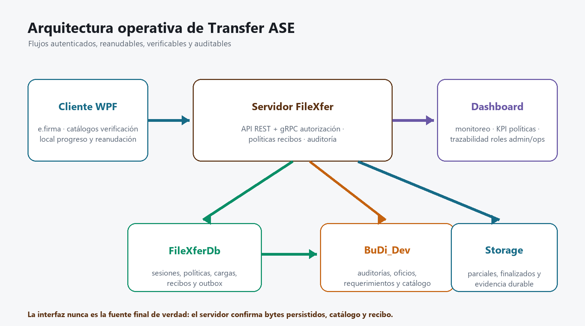

# Manual de operación de FileXfer.Server.Full

## Alcance

Este manual cubre preparación, configuración, publicación, validación, operación, monitoreo y rollback del servidor .NET 8 que expone API REST, gRPC, Dashboard, health checks, políticas, recibos y actualizaciones del cliente.



_Figura 1. El servidor coordina identidad, catálogo, almacenamiento y evidencia; ningún componente aislado confirma una carga completa._

## Principios de despliegue

- Publique artefactos generados por `build/Build-Release.ps1`; no copie `bin/Release` manualmente.
- Despliegue primero el servidor compatible y después cliente/updater.
- Use HTTPS y un nombre cubierto por el certificado.
- No coloque contraseñas, JWT, llaves privadas o cadenas productivas en archivos versionados.
- Ejecute preflight, migraciones, smoke tests y prueba funcional antes de abrir tráfico.
- Mantenga versión anterior, backups y procedimiento de rollback durante toda la ventana.

> **IMPORTANTE:** producción debe priorizar estabilidad y recuperación. Una publicación “rápida” sin rollback es una apuesta; una ventana de cambio no es un casino.

## Datos del entorno de desarrollo conocido

| Recurso | Valor de desarrollo | Observación |
|---|---|---|
| Servidor local | `192.168.2.243` | Use DNS cuando exista y asegure coincidencia TLS |
| IP pública informada | `187.141.128.194` | Requiere NAT, firewall y certificado válido |
| API local | `https://localhost:51136` | Solo desde el mismo equipo |
| Dashboard | `https://localhost:51136/admin/` | Acceso con e.firma |
| Health | `/healthz` | Vida del proceso |
| Readiness | `/readyz` | Dependencias y esquema disponibles |
| BuDi | `192.168.2.8` / `Budi_Dev` | Credencial externa al repositorio |
| FileXfer | `192.168.2.3\SQL2014` / `FileXferDev` | Credencial externa al repositorio |
| Storage del servicio instalado | `\\192.168.2.19\DocumentosBuzonDigital\Transfer\Finalizados` | Corresponde a BUZONDIGITAL; no usarlo para Budi_Dev |
| Storage de desarrollo | `\\192.168.2.21\DocumentosBuzonDigital_Pruebas\Transfer\Finalizados` | Corresponde al entorno Budi_Dev declarado |

Estos valores no autorizan producción. Usuario y contraseña de SQL deben obtenerse desde el mecanismo aprobado del entorno.

## Preparar el servidor Windows

### Requisitos

- Windows Server soportado y actualizado.
- .NET 8 Hosting Bundle para IIS o runtime correspondiente para servicio Windows.
- PowerShell 7.
- Acceso de red a FileXferDb, BuDi, storage, SMTP y hosts OCSP/CRL autorizados.
- Certificado TLS con llave privada.
- Cuenta de servicio dedicada, preferentemente gMSA.
- qpdf incluido en el paquete o ruta `FILEXFER_QPDF_PATH`.
- Espacio para binarios, staging, logs y archivos parciales.

### Preparar carpetas

| Carpeta | Uso | Permisos sugeridos |
|---|---|---|
| `C:\FileXfer\app` | Binarios activos | Lectura/ejecución para servicio; escritura solo despliegue |
| `C:\FileXfer\releases` | Versiones verificadas | Escritura del proceso de liberación |
| `C:\FileXfer\evidence` | Reportes de preflight | Lectura soporte; escritura despliegue |
| Storage configurado | Parciales y finalizados | Cuenta de servicio, SYSTEM, administradores autorizados |
| Carpeta de llave de recibos | PEM cifrado o protegido | Solo cuenta de servicio y administradores de seguridad |

No conceda ejecución a usuarios generales sobre el volumen de documentos. El servidor almacena archivos; no debe abrirlos ni ejecutarlos.

## Configuración obligatoria

### Variables principales

| Clave | Propósito | Regla |
|---|---|---|
| `ConnectionStrings__FileXferDb` | Base técnica | En producción: cifrado y certificado validado |
| `ConnectionStrings__BudiDev` | Catálogo BuDi | Apunta a la base autorizada del entorno |
| `Storage__BasePath` | Almacenamiento final | Ruta absoluta/UNC bajo ACL exclusiva |
| `Storage__MaxUploadBytes` | Tope global | `0` significa sin límite funcional; positivo impone límite |
| `Storage__MaxChunkBytes` | Tamaño de bloque gRPC | Mantenga un valor compatible con red y memoria |
| `Storage__ResumeRetentionHours` | Vida del parcial | Recomendado 72; rango permitido 1–168 |
| `AllowedHosts` | Hosts HTTP válidos | Lista explícita en producción, nunca `*` |
| `Security__Jwt__SigningKey` | Firma JWT | Secreto aleatorio de al menos 32 bytes |
| `Security__PathEncryptionKey` | Protección de rutas | Base64 de exactamente 32 bytes |
| `Security__LegacyPathEncryptionKey` | Compatibilidad de rutas BuDi | Conserve la llave histórica; DES utiliza sus primeros ocho caracteres |
| `Security__PathWriteFormat` | Formato de rutas nuevas | `LegacyDes` mientras otros sistemas compartan la columna cifrada |
| `Security__Receipts__PrivateKeyPemPath` | Firma de recibos | RSA persistente de 3072 bits o más |
| `Security__SAT__TrustedRootCertificatePaths__N` | Raíces SAT | Archivos de confianza explícitos |
| `Security__SAT__AllowedRevocationHosts__N` | OCSP/CRL | Allowlist estricta |

### Ejemplo sin secretos

```json
{
  "Kestrel": {
    "Endpoints": {
      "Https": {
        "Url": "https://0.0.0.0:51136",
        "Protocols": "Http1AndHttp2"
      }
    }
  },
  "ConnectionStrings": {
    "FileXferDb": "__DESDE_ALMACEN_SECRETO__",
    "BudiDev": "__DESDE_ALMACEN_SECRETO__"
  },
  "Storage": {
    "BasePath": "\\\\SERVIDOR\\RECURSO\\Transfer\\Finalizados",
    "MaxUploadBytes": 0,
    "MaxChunkBytes": 2097152,
    "ResumeRetentionHours": 72
  },
  "AllowedHosts": "transfer.empresa.gob.mx"
}
```

`0.0.0.0` sirve para escuchar en todas las interfaces; el usuario debe navegar a `localhost`, IP o DNS válido.

## Seguridad e identidad

### e.firma

- Cliente y Dashboard autentican exclusivamente con e.firma.
- No existen rutas runtime de MFA/TOTP.
- Producción exige cadena SAT, revocación y hosts OCSP/CRL autorizados.
- `AllowDevelopmentUntrustedChain` solo puede existir en Development.
- Cambios de rol, dispositivo o `SecurityVersion` invalidan sesiones anteriores.

### Recibos

Cada carga completada genera un recibo RSA-PSS-SHA256 con hash del archivo y encadenamiento al recibo anterior. La llave debe ser persistente. Rotarla sin soporte de llaves históricas rompe la verificación en línea de recibos anteriores.

### Alertas

El canal elegido es SMTP mediante outbox SQL. Si `Alerts__Enabled=true`, configure host, puerto, TLS, remitente y destinatarios. El worker ofrece entrega al menos una vez; el receptor debe tolerar duplicados.

## Preparar la liberación

### Construir

```powershell
pwsh -NoProfile -File build/Build-Release.ps1 `
  -Version 2.2.0.0 `
  -MinSupportedVersion 2.1.0.0 `
  -DownloadUrl "https://DNS_AUTORIZADO/transfer/TransferClienteASE-2.2.0.0-win-x64.zip" `
  -SigningKeyPath "RUTA_PRIVADA\transfer-update-private.pem" `
  -TrustedPublicKeyPath "RUTA_CONFIG\transfer-update-public.pem" `
  -CodeSigningCertificateThumbprint "HUELLA_CERTIFICADO" `
  -TimestampServer "URL_RFC3161_AUTORIZADA" `
  -ReleaseNotes "Descripción breve y verificable"
```

El paquete productivo requiere árbol Git limpio, firma del manifiesto, hash de artefactos, Authenticode y sellado de tiempo. `AllowUnsignedBinaries` produce únicamente una liberación no productiva.

### Verificar de forma independiente

```powershell
pwsh -NoProfile -File build/Verify-Release.ps1 `
  -ReleaseDirectory "D:\Releases\2.2.0.0" `
  -TrustedPublicKeyPath "D:\Configuracion\transfer-update-public.pem"
```

No publique si la verificación no termina correctamente.

## Preflight por fases

1. Copie `deployment/staging-readiness.example.json` fuera del repositorio.
2. Sustituya marcadores por DNS, rutas y nombres reales; no inserte secretos.
3. Suministre cadenas SQL mediante variables de entorno o almacén secreto.
4. Ejecute `Infrastructure`.
5. Aplique migraciones en el orden documentado.
6. Ejecute `PostMigration`.
7. Despliegue binarios.
8. Ejecute `PostDeploy`.

```powershell
pwsh -NoProfile -File deployment/Test-StagingReadiness.ps1 `
  -ConfigurationPath 'C:\FileXfer\staging-readiness.json' `
  -Phase Infrastructure `
  -ReportPath 'C:\FileXfer\evidence\01-infrastructure.json'
```

| Fase | Valida | Bloquea cuando |
|---|---|---|
| Configuration | Perfil y ausencia de secretos | Hay comodines, marcadores o configuración insegura |
| Infrastructure | DNS, SQL cifrado, storage, ACL y SMTP TLS | Una dependencia no es accesible o segura |
| PostMigration | Tablas, columnas, índices y migraciones | Falta contrato requerido |
| PostDeploy | HTTPS, health y readiness | Respuesta no es 200 o existe redirección inesperada |

> **NO CONTINÚE** a la fase siguiente si el reporte contiene `FAIL`, aunque otras filas estén correctas.

## Migraciones y orden de despliegue

1. Ejecute preflight de solo lectura de BuDi.
2. Cree backup consistente de FileXferDb, BuDi y storage; verifique restauración de muestra.
3. Drene nuevas cargas.
4. Ejecute `001_budi_transfer_archivos_hardening.sql`.
5. Ejecute en FileXferDb `002`, `003`, `004` y `005` en orden.
6. Ejecute `PostMigration`.
7. Instale el servidor y valide `/healthz` y `/readyz`.
8. Distribuya cliente y updater firmados.
9. Ejecute pruebas de login, catálogo, carga, reparación, reanudación y descarga.
10. Abra tráfico gradualmente.

## Ejecutar como servicio Windows

El proyecto llama `UseWindowsService()` y admite ejecución como servicio cuando se publica para Windows.

### Instalación controlada

1. Detenga o drene la versión anterior.
2. Copie el artefacto verificado a una carpeta nueva de versión.
3. Aplique ACL a binarios, configuración y llave de recibos.
4. Cree o actualice el servicio para ejecutar `FileXfer.Server.exe`.
5. Configure variables de entorno en el contexto del servicio.
6. Inicie el servicio.
7. Confirme evento de arranque, `/healthz` y `/readyz`.
8. No elimine la versión anterior hasta cerrar la ventana.

### Alternativa IIS

El paquete incluye `web.config` para ASP.NET Core Module V2 en modo in-process. Instale Hosting Bundle, configure sitio HTTPS y Application Pool sin código administrado. No opere simultáneamente IIS y servicio Windows sobre los mismos puertos.

## Validación funcional posterior

### Prueba mínima obligatoria

- Login cliente con e.firma válida y rechazo de una inválida.
- Login del Dashboard con rol correcto.
- Consulta de años, auditorías, oficios y requerimientos.
- PDF válido aceptado.
- PDF cifrado rechazado.
- PDF reparable reparado y revalidado.
- PDF con contenido activo rechazado.
- Interrupción y reanudación desde offset mayor que cero.
- Una sola fila de negocio y un solo recibo después del reintento.
- Descarga parcial con HTTP 206 y SHA-256 final correcto.
- Cambio de política con versión y motivo.

## Operación diaria

### Endpoints

| Endpoint | Correcto | Interpretación de falla |
|---|---|---|
| `/healthz` | HTTP 200 | Proceso no responde o no está vivo |
| `/readyz` | HTTP 200 | SQL, BuDi, storage o esquema no están listos |
| `/admin/` | Login e.firma | Estáticos, API o autorización fallaron |

### Métricas y trazas

- `ActivitySource`: `FileXfer.Server.Transfer`.
- `Meter`: `FileXfer.Server`.
- Monitoree tasa de éxito, fallas, latencia p95/p99, espacio, reinicios, outbox, dead-letter, reanudaciones, omisiones y recibos.
- Correlacione solicitudes con `TraceId`; no dependa de búsquedas por hora únicamente.

### Retención recomendada

| Elemento | Retención base |
|---|---|
| Parciales | 72 horas operativas; ajuste entre 1 y 168 |
| Outbox entregado | 30 días |
| Dead-letter | 90 días |
| Logs | 90 días en línea y 1 año archivado |
| Auditoría de seguridad | 1 año en línea y 7 años archivada |
| Archivos/recibos | 7 años como base, sujeto a Jurídico/Archivo |

No purgue archivos completados automáticamente hasta contar con clasificación, legal hold, cuarentena, doble aprobación y acta.

## Diagnóstico

| Síntoma | Causa frecuente | Acción |
|---|---|---|
| Navegador rechaza `0.0.0.0` | Se usó dirección de escucha | Use localhost, IP o DNS |
| health 200 y ready 503 | Dependencia no disponible | Revise detalle interno, SQL, storage y esquema |
| Login falla por OCSP/CRL | Allowlist o red incompleta | Autorice hosts SAT correctos; no desactive validación |
| Archivo llega pero no aparece | Falla de catálogo BuDi | Use recuperación idempotente y TraceId |
| Recibo inválido | Llave cambió o datos fueron alterados | Detenga publicación y revise raíz de confianza |
| Cargas grandes fallan | Límite global/política, timeout o espacio | `0` quita tope funcional; mantenga timeout de inactividad y capacidad |
| No reanuda | Parcial venció, archivo cambió o identidad/contexto distinto | Inicie carga nueva solo después de confirmar causa |
| Alertas no salen | SMTP/TLS o outbox/dead-letter | Revise configuración y reintentos; no revierta negocio |

## Rollback

1. Detenga tráfico y conserve logs y reportes.
2. Restaure primero el cliente anterior cuando sea necesario y después binarios de servidor/updater compatibles.
3. Restaure FileXferDb desde backup cuando la migración deba revertirse.
4. No elimine columnas BuDi en un rollback ordinario; son compatibles hacia atrás.
5. No borre el storage. Reconcile catálogo y archivos antes de limpiar.
6. Valide login, consulta y descarga con la versión anterior.
7. Reabra tráfico gradualmente.

## Evidencia de cierre de ventana

- Commit y versión desplegada.
- Hashes y verificación del manifiesto.
- Reportes `Infrastructure`, `PostMigration` y `PostDeploy`.
- Backup y prueba de restauración.
- Resultado de smoke tests.
- Capturas de health/readiness.
- Resultado de carga válida, rechazos y reanudación.
- TraceId y ReceiptId de la prueba controlada.
- Decisión de abrir tráfico o ejecutar rollback.
