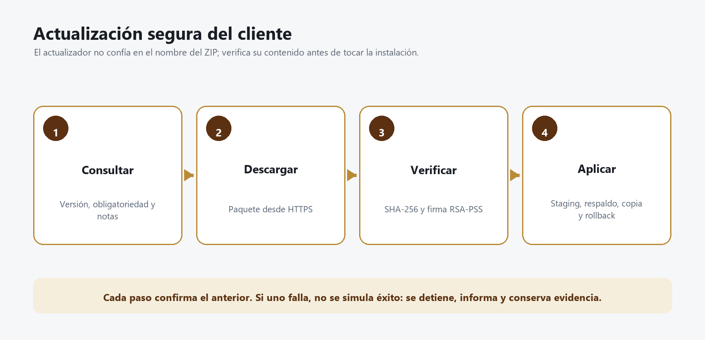

# Manual de TransferClienteASEUpdater

## Qué problema resuelve

El actualizador instala una versión nueva del cliente sin confiar ciegamente en el archivo descargado. Verifica hash, firma, estructura del ZIP y rutas internas; respalda la instalación y revierte si la aplicación falla.



_Figura 1. La instalación solo ocurre después de dos verificaciones: el cliente y el updater._

## Responsabilidades por componente

| Componente | Responsabilidad |
|---|---|
| Servidor | Publica versión, URL HTTPS, SHA-256, firma y notas |
| Cliente | Consulta, informa al usuario, descarga y valida antes de lanzar |
| Updater | Vuelve a validar, extrae de forma segura, respalda, aplica y revierte |
| Operación | Firma, verifica, publica por anillos y conserva versión anterior |

## Contrato de firma

La firma RSA-PSS-SHA256 se calcula sobre el contenido canónico:

```text
FILEXFER-UPDATE-V1
transfer-cliente-ase
<version>
<sha256-en-minúsculas>
```

La llave privada de liberación permanece fuera del repositorio. La llave pública confiable se distribuye con una versión anterior o mediante un proceso de bootstrap controlado.

> **IMPORTANTE:** cambiar silenciosamente `update-public.pem` rompe la cadena de confianza. La rotación requiere una versión puente firmada con la llave anterior y un periodo de solapamiento.

## Requisitos de liberación

- PowerShell 7, .NET 8 SDK, Node.js/npm y qpdf.
- Árbol Git limpio.
- Llave RSA privada de al menos 3072 bits, protegida.
- Llave pública correspondiente.
- Certificado Authenticode para producción.
- Servidor RFC 3161 para sellado de tiempo.
- URL final HTTPS disponible.

## Generar el paquete

Use el pipeline principal; no arme el ZIP a mano.

```powershell
pwsh -NoProfile -File build/Build-Release.ps1 `
  -Version 2.2.0.0 `
  -MinSupportedVersion 2.1.0.0 `
  -DownloadUrl "https://DNS_AUTORIZADO/transfer/TransferClienteASE-2.2.0.0-win-x64.zip" `
  -SigningKeyPath "D:\Secretos\transfer-update-private.pem" `
  -TrustedPublicKeyPath "D:\Configuracion\transfer-update-public.pem" `
  -CodeSigningCertificateThumbprint "HUELLA_CERTIFICADO" `
  -TimestampServer "URL_RFC3161_AUTORIZADA" `
  -ReleaseNotes "Cambios visibles para el usuario"
```

Si el PEM privado está cifrado, la contraseña se obtiene de `TRANSFER_RELEASE_SIGNING_KEY_PASSWORD`; no se pasa por argumento.

## Contenido esperado de una liberación

- ZIP firmado del cliente.
- ZIP del servidor.
- Scripts de despliegue.
- Updater autónomo.
- Símbolos PDB separados.
- Verificador independiente.
- Llave pública de bootstrap.
- Fragmento de configuración de actualización.
- Hashes SHA-256.
- Manifiesto y firma del manifiesto.

La salida nunca debe contener `.key`, llaves privadas, secretos ni contraseñas.

## Verificación independiente

```powershell
pwsh -NoProfile -File build/Verify-Release.ps1 `
  -ReleaseDirectory "D:\Releases\2.2.0.0" `
  -TrustedPublicKeyPath "D:\Configuracion\transfer-update-public.pem"
```

### Qué valida

- Firma del manifiesto.
- Hash y longitud de todos los artefactos.
- Firma canónica del cliente.
- Confinamiento de rutas del ZIP.
- Presencia de ejecutable, updater y llave pública.
- Ejecución del updater en modo `--verify-only`.
- Ausencia de material privado.

## Uso directo del ejecutable

La sintaxis interna es:

```text
TransferClienteASE.Updater <zip> <destino> <exe> <version> <sha256> <firmaBase64> <clavePublicaPem> [pidCliente|--verify-only]
```

No se recomienda escribir firma o hash manualmente en operación normal; el cliente y el pipeline construyen los argumentos.

### Modo de solo verificación

`--verify-only` comprueba paquete, firma, hash, rutas, tamaño y contenido obligatorio sin modificar la instalación. Úselo en el pipeline y antes de publicar.

## Secuencia de aplicación

1. Valida argumentos y normaliza rutas.
2. Rechaza destino raíz o fuera del ámbito permitido.
3. Carga la llave pública y exige tamaño criptográfico suficiente.
4. Calcula SHA-256 del ZIP y compara en tiempo constante.
5. Verifica firma RSA-PSS.
6. Extrae a staging temporal con límites.
7. Rechaza rutas absolutas, `..`, vínculos y zip-slip.
8. Confirma que existen cliente, updater y llave pública.
9. Copia el updater a una ubicación temporal aislada.
10. Espera el cierre del cliente cuando se proporcionó PID.
11. Respalda la instalación actual.
12. Aplica archivos.
13. Inicia el cliente actualizado.
14. Elimina staging y conserva log.

## Rollback automático

Si una copia falla, el updater restaura los archivos respaldados. Si la restauración también falla, registra cada error y termina con código no exitoso.

### Qué no debe hacer soporte

- No deshabilitar la firma para “salir del paso”.
- No extraer el ZIP directamente sobre la instalación activa.
- No borrar el respaldo antes de validar inicio.
- No cambiar la llave pública por una enviada por correo.
- No ignorar una firma inválida aunque el hash coincida.

## Publicación por anillos

| Anillo | Población | Criterio de avance |
|---|---|---|
| Técnico | Equipos de desarrollo/soporte | Verificación, inicio, carga y rollback correctos |
| Piloto | Grupo reducido de usuarios | Sin aumento de fallas y actualización recuperable |
| General | Población autorizada | Métricas estables y paquete anterior disponible |

1. Publique el ZIP en la URL definitiva.
2. Descárguelo desde otro equipo y confirme SHA-256.
3. Actualice la configuración firmada del servidor.
4. Habilite el anillo técnico.
5. Observe errores de descarga, firma, inicio y rollback.
6. Amplíe al piloto y después a general.

## Mensajes y diagnóstico

| Mensaje | Significado | Acción |
|---|---|---|
| Hash no coincide | Descarga incompleta o artefacto sustituido | Retire publicación y vuelva a verificar origen |
| Firma inválida | Paquete no autorizado o llave equivocada | No instale; revise cadena de liberación |
| Paquete incompleto | Faltan archivos obligatorios | Reconstruya con el pipeline |
| Ruta insegura | ZIP intenta salir de staging | Trate como incidente; no extraiga manualmente |
| Actualización falló; instalación restaurada | Rollback automático terminó | Revise log antes de reintentar |
| Rollback incompleto | Estado local puede ser inconsistente | Aísle equipo y restaure versión conocida |
| No se puede atravesar vínculo | Destino contiene reparse point | Corrija instalación y ACL |

## Ubicación del log

Los logs se guardan bajo la carpeta temporal del usuario en `TransferClienteASEUpdate\logs`. Conserve el archivo de la ejecución fallida junto con versión, hora, equipo y hash del paquete.

## Prueba de aceptación

- `--verify-only` devuelve éxito.
- Authenticode y timestamp son válidos.
- El cliente activo se cierra de forma controlada.
- La actualización conserva configuración autorizada.
- La nueva versión inicia y muestra número correcto.
- Login e.firma funciona sin MFA.
- Una carga pequeña se completa y emite recibo.
- Una prueba de rollback restaura la versión anterior.
- El paquete anterior sigue disponible durante la ventana.

## Recuperación manual autorizada

Solo cuando el rollback automático quedó incompleto:

1. Detenga cliente y updater.
2. Copie logs y evidencia; no borre temporales todavía.
3. Verifique que la carpeta de respaldo corresponde a esa instalación.
4. Restaure el artefacto anterior verificado en una carpeta limpia.
5. Reaplique configuración sin copiar secretos a archivos versionados.
6. Valide firma, versión, login y carga controlada.
7. Documente la causa antes de reintentar la actualización.
