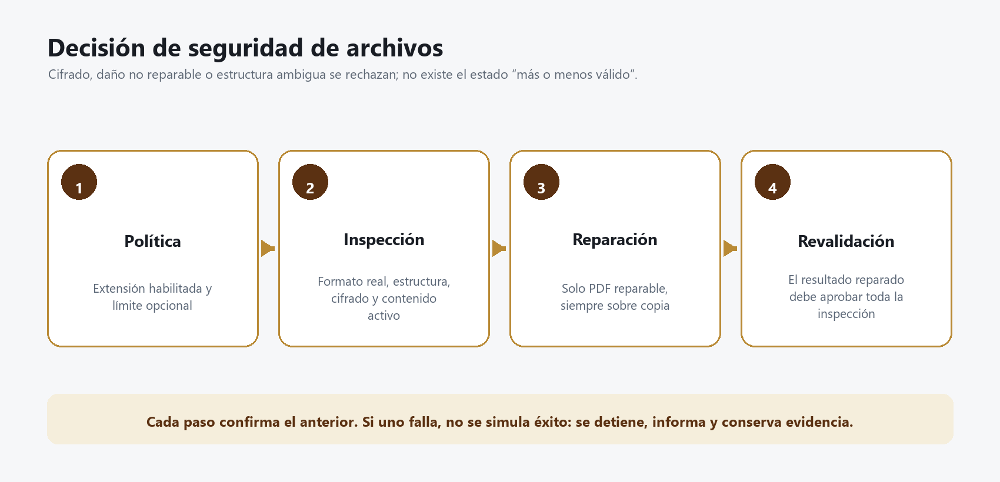

# Manual técnico de FileXfer.Pdf y FileSafety

## Objetivo

`FileXfer.Pdf` es la compuerta común de inspección de archivos. Valida que la extensión esté autorizada, revisa la estructura del formato, detecta cifrado o contraseña, bloquea contenido activo y, para PDF reparable, trabaja sobre una copia, repara y vuelve a validar.



_Figura 1. Una reparación no es un atajo: reinicia la validación sobre el resultado._

## Garantías y límites

### Sí garantiza

- Aplicación de política efectiva por extensión.
- Revisión de tamaño cuando existe límite explícito.
- Identificación de estructura conocida.
- Detección de cifrado/contraseña en formatos soportados.
- Detección de macros, relaciones externas, rutas peligrosas y expansión excesiva en contenedores compatibles.
- Validación de contenido estructurado e imágenes comunes.
- Reparación controlada de PDF cuando qpdf demuestra que es posible.
- Preservación del original.
- Progreso observable y limpieza de staging.

### No garantiza

- Ausencia de malware; no hay antivirus/EDR integrado actualmente.
- Validez jurídica del contenido.
- Corrección semántica de cifras o texto.
- Seguridad de un formato propietario sin validador.
- Ausencia de contraseña cuando la política omite inspección profunda.

> **IMPORTANTE:** validación estructural y antivirus no son sinónimos. La primera evita archivos mal formados o con características prohibidas; la segunda busca código malicioso conocido o comportamientos sospechosos.

## Políticas por extensión

Cada política versionada contiene:

| Campo | Significado |
|---|---|
| Extensión | Identificador normalizado, por ejemplo `.pdf` |
| Habilitada | Permite o bloquea la carga |
| Verificación profunda | Ejecuta validador específico cuando está activa |
| Máximo opcional | `null`/vacío equivale a sin límite por política |
| Versión | Número inmutable para trazabilidad |
| Motivo y responsable | Evidencia administrativa del cambio |

El cliente consume la política mínima efectiva. El Dashboard expone metadatos de auditoría solo a `admin/ops` y permite cambios únicamente a `admin`.

### Sin límite

En las opciones del servidor y del motor, `0` significa **sin límite funcional**. Un valor positivo impone el tope. Esto no elimina controles de cuota, timeout de inactividad, capacidad de disco ni límite de un tipo de archivo cuando la política lo especifica.

## Categorías verificadas

| Categoría | Ejemplos | Controles principales |
|---|---|---|
| PDF | `.pdf` | Cifrado, estructura, páginas, acciones, adjuntos y reparación qpdf |
| Office moderno | `.docx`, `.xlsx`, `.pptx` | ZIP seguro, tipo OOXML, cifrado, macros y relaciones externas |
| OpenDocument | `.odt`, `.ods`, `.odp` | Contenedor, mimetype, cifrado y rutas internas |
| EPUB/XPS/Visio | `.epub`, `.xps`, formatos compatibles | Contenedor, expansión, rutas y relaciones |
| Texto estructurado | `.json`, `.xml`, `.svg` | Sintaxis, entidades/recursos externos y contenido activo |
| Texto simple | `.txt`, `.csv`, `.ini`, `.cfg` | Lectura acotada, codificación y estructura esperada |
| Imágenes | `.png`, `.jpg`, `.gif`, `.bmp` | Firma del formato, estructura y checksums aplicables |
| Certificados | `.cer`, `.crt`, `.pem` | Parseo y estructura del certificado |
| Formatos propietarios/legados | `.doc`, `.xls`, `.dwg`, otros | Se bloquean cuando no puede demostrarse integridad y ausencia de contraseña |

Las extensiones concretas permitidas se gobiernan desde el Dashboard. La presencia de un validador no obliga a habilitar la extensión.

## Inspección de PDF

### Dependencia qpdf

El ejecutable se incluye en el paquete bajo `qpdf\bin` o se resuelve con `FILEXFER_QPDF_PATH`. El arranque y las pruebas deben confirmar una ruta ejecutable.

### PDF válido

Un PDF es aceptable cuando:

- qpdf puede abrir y verificar su estructura.
- No requiere contraseña.
- No contiene acciones o adjuntos prohibidos.
- Cumple la política efectiva.
- El hash del resultado persistido coincide.

### PDF protegido

Si qpdf informa cifrado o contraseña, se rechaza. El sistema no intenta adivinar, eliminar ni almacenar contraseñas. El usuario debe proporcionar una copia institucional sin protección.

### PDF dañado reparable

1. Se crea una copia aislada.
2. qpdf intenta reconstruir estructura válida.
3. El original no se modifica.
4. Se inspecciona el archivo reparado desde cero.
5. Solo si aprueba, se continúa con la carga.
6. Se informa al usuario que hubo reparación.

### PDF no reparable

Se rechaza y se limpia staging. El estado no debe permanecer como pendiente de enviar. Para reintentar, el usuario debe generar una copia distinta y seleccionarla explícitamente.

### Contenido activo

Acciones automáticas, JavaScript, Launch, archivos adjuntos o capacidades equivalentes se rechazan. “El archivo abre en mi visor” no demuestra que sea seguro para un repositorio institucional.

## Validación de contenedores ZIP

Office, OpenDocument, EPUB y XPS son contenedores. Los controles incluyen:

- Rutas absolutas o segmentos `..`.
- Entradas duplicadas o ambiguas.
- Vínculos y tipos no permitidos.
- Relación de compresión excesiva.
- Tamaño expandido acumulado.
- Macros o contenido activo.
- Paquetes cifrados.
- Relaciones externas.
- Archivos obligatorios del formato.

Un ZIP renombrado como `.docx` se rechaza si no cumple el contrato OOXML.

## Texto, XML, JSON y SVG

### JSON

- Debe parsear completamente.
- No se acepta contenido truncado o datos extra inesperados.
- Se limita el análisis estructurado para evitar consumo desproporcionado.

### XML

- Se deshabilitan resoluciones externas peligrosas.
- Se controla profundidad y tamaño.
- Se rechaza una estructura rota.

### SVG

- Se trata como XML activo, no como imagen inofensiva.
- Se bloquean scripts, eventos, referencias externas y contenido ejecutable.

## Imágenes y certificados

- PNG valida firma, estructura de chunks y CRC.
- JPEG/GIF/BMP se identifican por contenido y estructura esperada.
- CER/CRT/PEM deben parsear como certificado válido.
- Una extensión correcta con contenido de otro tipo se rechaza.

## Estados de inspección

| Estado | Decisión | Mensaje al usuario |
|---|---|---|
| `Accepted` | Continuar | Archivo verificado |
| `Repaired` | Continuar con copia | Reparado y revalidado |
| `Encrypted` | Rechazar | Tiene contraseña o cifrado |
| `Damaged` | Rechazar | Dañado y no reparable |
| `ActiveContent` | Rechazar | Contenido activo no permitido |
| `TooLarge` | Rechazar | Supera límite explícito |
| `Unsupported` | Rechazar | Formato no verificable |
| `PolicyBlocked` | Rechazar | Extensión deshabilitada |

La interfaz puede usar textos localizados, pero la decisión debe conservar un código estable para auditoría.

## Progreso y experiencia de usuario

Una inspección debe publicar:

- Acción actual: copiando, verificando, reparando o revalidando.
- Porcentaje del archivo actual.
- Índice `n/N`.
- Porcentaje total del lote.
- Resultado final con causa concreta.

El progreso debe ser monótono: nunca retrocede. Al fallar, el elemento queda rechazado, no pendiente. El usuario puede retirarlo y continuar con los válidos.

## Doble validación

| Momento | Motivo |
|---|---|
| Cliente | Informar temprano y evitar transferir algo obviamente inválido |
| Servidor | No confiar en el cliente y verificar los bytes realmente persistidos |

La decisión final pertenece al servidor. Un cliente modificado no puede autorizar por sí mismo un archivo.

## Integración de código

### Opciones de tamaño

```csharp
public long MaxFileBytes { get; init; } = 0; // 0 = sin límite funcional

private bool HasFileSizeLimit => _options.MaxFileBytes > 0;
```

### Patrón seguro

```text
consultar política
crear copia aislada
inspeccionar
si es reparable: reparar la copia
revalidar desde cero
transferir
releer storage y calcular SHA-256
catalogar y emitir recibo
limpiar temporales
```

No abra archivos con aplicaciones de escritorio en el servidor y no ejecute contenido del documento.

## Errores comunes de mantenimiento

| Mala práctica | Consecuencia | Corrección |
|---|---|---|
| Confiar en extensión | Disfraz de formato | Inspeccionar firma y estructura |
| Reparar el original | Pérdida de evidencia | Trabajar sobre copia |
| Aceptar después de qpdf repair sin revisar | Contenido reparado pero inseguro | Revalidar todo |
| Omitir verificación para resolver un ticket | Riesgo invisible | Registrar excepción y aceptar riesgo formalmente |
| Mantener rechazado como pendiente | Reintentos infinitos y confusión | Marcar fallido/rechazado y permitir quitar |
| Tratar `0` como cero bytes | Bloqueo total accidental | Interpretar `0` como sin límite |
| Cargar todo en memoria | Agotamiento con archivos grandes | Usar streams y bloques |

## Pruebas obligatorias

### PDF

```powershell
dotnet run --project FileXfer.Pdf.SmokeTests/FileXfer.Pdf.SmokeTests.csproj -c Release -- tools/qpdf/win-x64/bin/qpdf.exe
```

Debe aceptar válido, rechazar cifrado y activo, reparar/revalidar el reparable, mantener el original y limpiar staging.

### FileSafety

```powershell
dotnet run --project FileXfer.FileSafety.SmokeTests/FileXfer.FileSafety.SmokeTests.csproj -c Release
```

Debe probar paquetes, macros, relaciones externas, JSON, SVG, imagen, progreso, limpieza, ausencia de límite por defecto y rechazo cerrado de lo no soportado.

## Incorporar un nuevo formato

1. Defina amenazas del formato.
2. Determine si puede detectarse contraseña/cifrado.
3. Identifique estructura mínima y contenido activo.
4. Implemente lectura por stream con límites de recursos.
5. Agregue muestras válidas, dañadas, cifradas y maliciosas.
6. Mantenga fail-closed ante ambigüedad.
7. Agregue política inicial bloqueada si aún no existe aceptación formal.
8. Documente costo, limitaciones y motivo administrativo.
9. Ejecute smoke tests y carga integral.

## Respuesta ante un falso positivo o falso negativo

- Conserve hash, política, versión del validador y muestra en cuarentena autorizada.
- No relaje globalmente una política por un solo archivo.
- Reproduzca con prueba mínima.
- Determine si el problema es estructura, detector, qpdf o política.
- Corrija y agregue prueba de regresión.
- Si un archivo inseguro fue aceptado, trate como incidente y localice cargas por hash/política.
