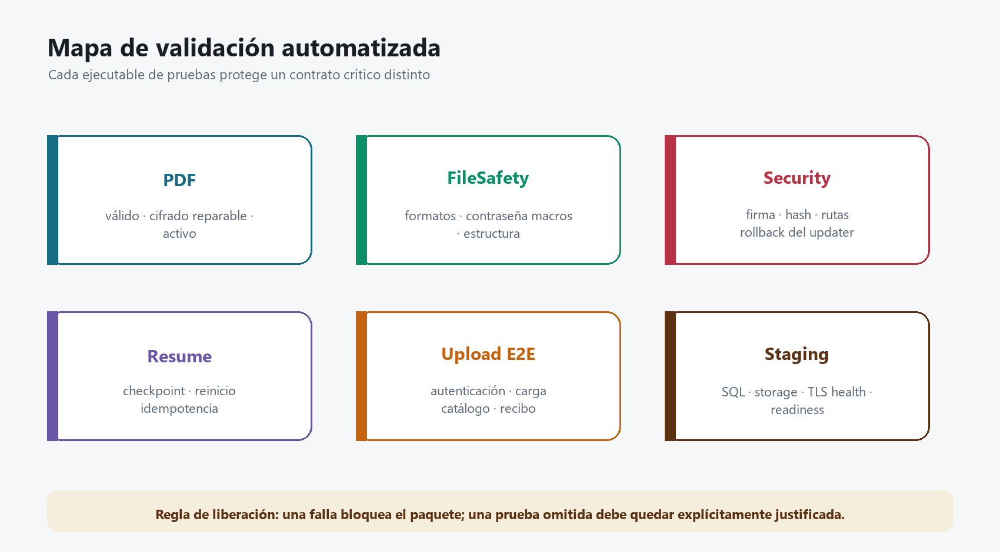

# Manual de pruebas automatizadas de Transfer ASE

## Propósito

Los proyectos SmokeTests demuestran contratos críticos con ejecutables simples y códigos de salida. Este manual indica qué cubre cada uno, cómo ejecutarlo y qué evidencia conservar antes de liberar.



_Figura 1. Las pruebas se complementan; aprobar PDF no demuestra autorización, persistencia o reanudación._

## Inventario de proyectos

| Proyecto | Contrato protegido |
|---|---|
| `FileXfer.Pdf.SmokeTests` | PDF válido, cifrado, activo, reparable y limpieza |
| `FileXfer.FileSafety.SmokeTests` | Validadores de formatos, progreso y fail-closed |
| `FileXfer.Security.SmokeTests` | Criptografía, autorización, políticas, recibos, updater y descarga |
| `FileXfer.Resume.SmokeTests` | Checkpoint durable del servidor |
| `TransferClienteASE.Resume.SmokeTests` | Diario local, restauración y exclusión de rechazados |
| `FileXfer.Upload.E2E.SmokeTests` | Flujo real FileXferDb + BuDi + storage + recibo |
| `deployment/Test-StagingReadiness.Smoke.ps1` | Perfil seguro y bloqueo de configuración insegura |

## Preparación común

1. Use .NET 8 SDK y PowerShell 7.
2. Trabaje con el commit que se pretende liberar.
3. Restaure dependencias.
4. Confirme qpdf bajo `tools/qpdf/win-x64/bin/qpdf.exe`.
5. No ejecute E2E contra producción.
6. Configure SQL y storage de desarrollo autorizados.
7. Conserve salida completa y código de salida.

```powershell
dotnet --info
dotnet restore FileXfer.Server.Full/FileXfer.Server.csproj
dotnet restore TransferClienteASE/TransferClienteASE.csproj
```

> **IMPORTANTE:** una línea `PASS` aislada no basta si el proceso termina con error después. Registre salida completa y confirme código de salida `0`.

## Prueba de PDF

### Ejecución autocontenida

```powershell
dotnet run --project FileXfer.Pdf.SmokeTests/FileXfer.Pdf.SmokeTests.csproj -c Release -- tools/qpdf/win-x64/bin/qpdf.exe
```

### Resultado esperado

```text
PASS valid=accepted pages=1
PASS encrypted=rejected
PASS active-content=rejected
PASS attachment-annotation=rejected
PASS damaged=detected repaired=revalidated original=unchanged staging=cleaned
```

### Modo con cuatro muestras externas

Proporcione, en orden, PDF válido, cifrado, reparable, con contenido activo y finalmente qpdf.

```powershell
dotnet run --project FileXfer.Pdf.SmokeTests/FileXfer.Pdf.SmokeTests.csproj -c Release -- `
  C:\Muestras\valido.pdf `
  C:\Muestras\cifrado.pdf `
  C:\Muestras\reparable.pdf `
  C:\Muestras\activo.pdf `
  tools\qpdf\win-x64\bin\qpdf.exe
```

## Prueba FileSafety

```powershell
dotnet run --project FileXfer.FileSafety.SmokeTests/FileXfer.FileSafety.SmokeTests.csproj -c Release
```

Debe confirmar:

- Paquete válido aceptado.
- Paquete cifrado, macro y relación externa bloqueados.
- JSON válido y dañado diferenciados.
- SVG activo bloqueado.
- CRC de imagen validado.
- Progreso monótono.
- Temporales limpiados y original intacto.
- Sin límite de tamaño por defecto y límite explícito soportado.
- Formato no soportado rechazado de forma cerrada.

## Prueba de seguridad

Primero publique o compile el updater que se probará.

```powershell
dotnet run --project FileXfer.Security.SmokeTests/FileXfer.Security.SmokeTests.csproj -c Release -- `
  C:\Ruta\TransferClienteASE.Updater.exe
```

### Áreas cubiertas

| Área | Validación |
|---|---|
| Protección de rutas | Roundtrip, aleatoriedad y rechazo de alteración |
| SQL | Transporte cifrado, certificado y rechazo de LocalDB productivo |
| Alertas | HTTPS/TLS, timeouts, outbox, leases, deduplicación y reintentos |
| Autenticación | Solo e.firma, sin rutas MFA |
| Autorización | Propietario, privilegio con e.firma y bloqueo entre RFC |
| Nombres | Canonicalización y sufijos peligrosos |
| Admisión | Cuotas previas y liberación de cupo |
| Políticas | Versiones, conflicto, bypass, límite y rollback |
| Recibos | RSA-PSS, llave confiable, cadena, idempotencia y tamper |
| Reanudación | Offset físico, append, hash y reparse points |
| Descarga | Hash, traversal y alteración bloqueados |
| Updater | Firma, paquete completo, verify-only, rollback y zip-slip |

Un `SKIP` de reparse points puede aparecer cuando Windows no permite crear vínculos. Documente el motivo; no lo convierta en aprobación productiva automática.

## Reanudación del servidor

```powershell
dotnet run --project FileXfer.Resume.SmokeTests/FileXfer.Resume.SmokeTests.csproj -c Release
```

Resultado esperado:

```text
PASS: server truncates uncommitted tail and resumes from durable checkpoint.
```

Esto demuestra que una cola no confirmada se descarta y la carga continúa desde el último checkpoint durable.

## Reanudación del cliente

```powershell
dotnet run --project TransferClienteASE.Resume.SmokeTests/TransferClienteASE.Resume.SmokeTests.csproj -c Release
```

Resultado esperado:

```text
PASS: journal restores resumable work, excludes rejected files and permits explicit reselection.
```

El diario debe restaurar trabajo reanudable, excluir rechazados y permitir que el usuario seleccione de nuevo una copia corregida.

## Prueba integral de carga

Esta prueba usa la identidad de desarrollo **Juan Manuel Carrillo Rojo**, RFC `CARJ721209SD2`, y un contexto BuDi controlado. Está diseñada para `Budi_Dev`, `FileXferDev` y storage de pruebas; no debe ejecutarse en producción.

### Precondiciones

- Servidor disponible en `https://localhost:51136` o `TRANSFER_API_URL`.
- Configuración del servidor apuntando a `Budi_Dev` en `192.168.2.8`.
- Configuración de FileXfer apuntando a `FileXferDev` en `192.168.2.3\SQL2014`.
- Usuario de prueba activo, sin MFA.
- Año 2023, ente 15104, auditoría 5015, acto 1, oficio 27570 y requerimiento 24604 disponibles.
- qpdf accesible.
- Cadenas resueltas desde configuración segura o user-secrets; no pasarlas en la línea de comandos.

### Ejecutar flujo completo

```powershell
dotnet run --project FileXfer.Upload.E2E.SmokeTests/FileXfer.Upload.E2E.SmokeTests.csproj -c Release -- `
  C:\Proyectos\2027\Transfer
```

### Qué debe demostrar

- PDF válido verificado, cargado y con recibo.
- Reintento idempotente con el mismo recibo.
- Fila de negocio eliminada lógicamente reactivada y visible.
- PDF dañado reparado, revalidado y enviado con aviso.
- PDF cifrado, activo y extensión no soportada rechazados sin carga.
- Corte de red reanudado desde offset mayor que cero.
- Persistencia coherente en FileXferDb, BuDi y storage.
- Hash y firma de recibo verificados.
- Cero duplicados de negocio.
- Limpieza lógica de filas de prueba.

### Recuperar una falla de catálogo

El modo `--recover` reusa los bytes ya custodiados y completa catálogo/recibo sin duplicar negocio. Use únicamente el identificador informado por una ejecución controlada.

```powershell
dotnet run --project FileXfer.Upload.E2E.SmokeTests/FileXfer.Upload.E2E.SmokeTests.csproj -c Release -- `
  C:\Proyectos\2027\Transfer --recover <IDENTIFICADOR>
```

### Probar descarga real

```powershell
dotnet run --project FileXfer.Upload.E2E.SmokeTests/FileXfer.Upload.E2E.SmokeTests.csproj -c Release -- `
  C:\Proyectos\2027\Transfer --download <ID_ARCHIVO_LOCAL>
```

Debe confirmar autorización, descarga, tamaño y SHA-256.

> **NO INTERRUMPA** la prueba E2E cerrando la consola durante su limpieza, salvo que esté probando recuperación de manera intencional. Si se interrumpe, revise las filas marcadas con el `runId` antes de repetir.

## Preflight de staging

```powershell
pwsh -NoProfile -File deployment/Test-StagingReadiness.Smoke.ps1
```

La prueba demuestra que un perfil seguro es aceptado y que uno inseguro es bloqueado. La validación real del entorno usa `Test-StagingReadiness.ps1` en fases Infrastructure, PostMigration y PostDeploy.

## Orden recomendado antes de liberar

1. Compilación Release del servidor.
2. Compilación Release del cliente.
3. Compilación Release del updater.
4. PDF SmokeTests.
5. FileSafety SmokeTests.
6. Resume servidor.
7. Resume cliente.
8. Security SmokeTests con updater publicado.
9. StagingReadiness Smoke.
10. E2E contra desarrollo/staging controlado.
11. Verificador independiente de la liberación.
12. Prueba manual gráfica de cliente y Dashboard.

## Criterio de aprobación

| Resultado | Decisión |
|---|---|
| Todos PASS, código 0 y evidencia completa | Puede avanzar a siguiente puerta |
| FAIL reproducible | Bloquee la liberación |
| SKIP previsto con justificación | Evalúe control compensatorio antes de avanzar |
| Prueba no ejecutada | Estado no verificado; no equivale a PASS |
| Salida incompleta o consola cerrada | Repita y capture evidencia |

## Evidencia que debe conservarse

- Commit y rama.
- Versión de .NET, PowerShell, Node y qpdf.
- Hora de inicio/fin.
- Comando ejecutado sin secretos.
- Salida estándar y error.
- Código de salida.
- `runId`, TraceId y ReceiptId del E2E.
- Reportes JSON de preflight.
- Hashes de artefactos.
- Nombre del responsable que aprobó.

## Diagnóstico de fallas

| Falla | Revise | No haga |
|---|---|---|
| No encuentra qpdf | Ruta del ejecutable y permisos | Copiar un binario no verificado |
| SQL no conecta | DNS/instancia, TLS, cuenta y firewall | Pegar contraseña en el log |
| E2E no encuentra requerimiento | Datos BuDi y SP `PA_Consulta_RequerimientosByIdOficioV2` | Cambiar IDs al azar |
| Recibo inválido | Llave confiable y persistencia | Regenerar recibo para ocultar la causa |
| Resume vuelve a cero | Hash, tamaño, contexto y retención | Unir parciales manualmente |
| FileSafety acepta muestra activa | Detector y prueba de regresión | Desactivar validación global |
| Updater falla firma | Canonicalización, hash y llave | Instalar el ZIP manualmente |

## Mantenimiento de pruebas

Cuando se corrige un defecto, agregue primero o junto con la corrección una prueba que lo reproduzca. Mantenga muestras pequeñas, deterministas y autocontenidas. Una prueba que depende de “el archivo que estaba en Descargas de Juan” no es automatización; es folclor técnico.
